# The iSEE cookbook

## Introduction

This vignette consists of a series of (independent) hands-on recipes,
aimed at exploring the capabilities of
*[iSEE](https://bioconductor.org/packages/3.23/iSEE)* (Rue-Albrecht et
al. 2018) both interactively and programmatically. Each recipe consists
of a short task and a screen shot of the desired appearance of the app
instance that should be created. For each recipe, we provide a set of
hints, as well as detailed instructions on how to solve the task both
interactively (by clicking in the app) and programmatically (by directly
setting up and launching the desired app instance).

For a general overview of the default `iSEE` panels, we refer to the
[overview
vignette](https://iSEE.github.io/iUSEiSEE/articles/d02_iSEE_overview.md).
For all the details about the panel classes and the associated slots, we
refer to the help pages for the respective panel class (e.g.,
[`?ReducedDimensionPlot`](https://isee.github.io/iSEE/reference/ReducedDimensionPlot-class.html)).

## Prepare the session

Before starting with the recipes, we need to load the required packages
and the demo data set.

\
[`library`](https://rdrr.io/r/base/library.html)`(`[`"iSEE"`](https://isee.github.io/iSEE/)`)`\
[`library`](https://rdrr.io/r/base/library.html)`(`[`"iSEEu"`](https://github.com/iSEE/iSEEu)`)`\
\
`sce`` ``<-`` `[`readRDS`](https://rdrr.io/r/base/readRDS.html)`(`\
`  `[`system.file`](https://rdrr.io/r/base/system.file.html)`(``"datasets"``, ``"sce_pbmc3k.RDS"``, package ``=`` ``"iUSEiSEE"``)`\
`)`\
`sce`\
`#> class: SingleCellExperiment `\
`#> dim: 32738 2643 `\
`#> metadata(0):`\
`#> assays(2): counts logcounts`\
`#> rownames(32738): MIR1302-10 FAM138A ... AC002321.2 AC002321.1`\
`#> rowData names(19): ENSEMBL_ID Symbol_TENx ... FDR_cluster11`\
`#>   FDR_cluster12`\
`#> colnames(2643): Cell1 Cell2 ... Cell2699 Cell2700`\
`#> colData names(24): Sample Barcode ... labels_ont cell_ontology_labels`\
`#> reducedDimNames(3): PCA TSNE UMAP`\
`#> mainExpName: NULL`\
`#> altExpNames(0):`

## The cookbook

What follows is a list of 11 small self-contained recipes, that each
tries to address one specific aim - and provide accordingly a simple,
targeted solution.

### Recipe 1: Panel organisation

Using the `pbmc3k` data set, create an app that contains only a reduced
dimension plot panel, a row data plot panel and a column data plot
panel. The widths of the three panels should be 3, 4 and 5 units,
respectively.

Hints

- Panels can be added, removed and resized via the `Organization` button
  in the top right corner of the app.
- To pre-specify the panels to be included in the app, use the `initial`
  argument to
  [`iSEE()`](https://isee.github.io/iSEE/reference/iSEE.html).
- You can remind yourself of the list of slot names available for each
  panel class and their respective value using the
  [`str()`](https://rdrr.io/r/utils/str.html) function on any instance
  of a panel object, e.g. `str(ReducedDimensionPlot())`.
- For more information about the different types of panels, see the
  [overview
  vignette](https://iSEE.github.io/iUSEiSEE/articles/d02_iSEE_overview.md)
  or the help pages for the respective panel classes.

Solution (interactively)

- First open an application with the default set of panels.
  \
  `app`` ``<-`` `[`iSEE`](https://isee.github.io/iSEE/reference/iSEE.html)`(``sce``)`\
  `shiny``::`[`runApp`](https://rdrr.io/pkg/shiny/man/runApp.html)`(``app``)`
- Click on the `Organization` button in the top right corner of the app,
  and then click on `Organize panels`.
- In the pop-up window that appears, click on the little `x` next to all
  the panels that you want to remove (all but the
  `Reduced dimension plot 1`, `Column data plot 1` and
  `Row data plot 1`).
- Drag and drop the remaining three panel names in the correct order.
- For each panel, set the correct panel width by modifying the value in
  the `Width` dropdown menu.
- Click `Apply settings`.

Solution (programmatically)

\
`app`` ``<-`` `[`iSEE`](https://isee.github.io/iSEE/reference/iSEE.html)`(``sce``, initial ``=`` `[`list`](https://rdrr.io/r/base/list.html)`(`\
`  `[`ReducedDimensionPlot`](https://isee.github.io/iSEE/reference/ReducedDimensionPlot-class.html)`(``PanelWidth ``=`` ``3L``)``,`\
`  `[`RowDataPlot`](https://isee.github.io/iSEE/reference/RowDataPlot-class.html)`(``PanelWidth ``=`` ``4L``)``,`\
`  `[`ColumnDataPlot`](https://isee.github.io/iSEE/reference/ColumnDataPlot-class.html)`(``PanelWidth ``=`` ``5L``)`\
`)``)`

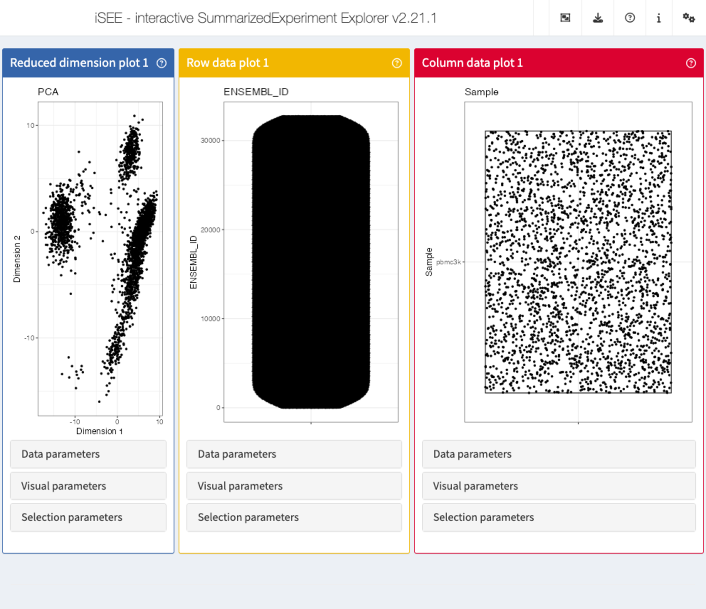

### Recipe 2: Data parameters configuration - selecting columns to display

Using the `pbmc3k` data set, visualize the cell type assignment against
the cluster membership, with the aim to identify the predominant cell
type in each cluster. In this case, since both cell annotations are
categorical, `iSEE` will generate a so called Hinton plot.

Hints

- Column (in this case cell) annotations can be visualized using a
  `ColumnDataPlot` panel.
- The cluster labels are available in the `Cluster` column of
  `colData(sce)`.
- The cell type assignments are available in the `labels_fine` column of
  `colData(sce)` (more coarse-grained assignments are provided in the
  `labels_main` column).
- `iSEE` will automatically determine the plot type depending on the
  type of selected variables.

Solution (interactively)

- First open an application with a single `ColumnDataPlot` panel
  spanning the full application window)
  \
  `app`` ``<-`` `[`iSEE`](https://isee.github.io/iSEE/reference/iSEE.html)`(``sce``, initial ``=`` `[`list`](https://rdrr.io/r/base/list.html)`(`[`ColumnDataPlot`](https://isee.github.io/iSEE/reference/ColumnDataPlot-class.html)`(``PanelWidth ``=`` ``12L``)``)``)`\
  `shiny``::`[`runApp`](https://rdrr.io/pkg/shiny/man/runApp.html)`(``app``)`
- In the `ColumnDataPlot` panel, click to expand the `Data parameters`
  collapsible box.
- Under `Column of interest (Y-axis)`, select the label column (e.g.,
  `labels_fine`).
- Under `X-axis`, select `Column data`, and under
  `Column of interest (X-axis)`, select `Cluster`.

Solution (programmatically)

\
`app`` ``<-`` `[`iSEE`](https://isee.github.io/iSEE/reference/iSEE.html)`(``sce``, `[`list`](https://rdrr.io/r/base/list.html)`(`\
`  `[`ColumnDataPlot`](https://isee.github.io/iSEE/reference/ColumnDataPlot-class.html)`(`\
`    PanelWidth ``=`` ``12L``, XAxis ``=`` ``"Column data"``,`\
`    YAxis ``=`` ``"labels_fine"``, XAxisColumnData ``=`` ``"Cluster"`\
`  ``)`\
`)``)`

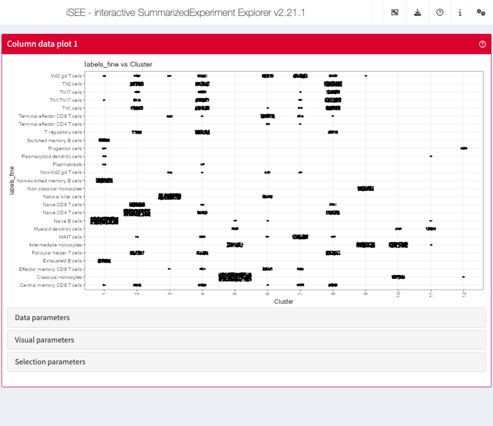

### Recipe 3: Data parameters configuration - displaying multiple reduced dimension representations

Using the `pbmc3k` data set, display both the tSNE and UMAP
representations next to each other.

Hints

- Reduced dimension representations can be displayed using
  `ReducedDimensionPlot` panels.
- The reduced dimension representations in the SingleCellExperiment
  object can be accessed by name (`reducedDimNames(sce)` lists the
  available representations).

Solution (interactively)

- First open an application with two `ReducedDimensionPlot` panels, each
  spanning half the application window)
  \
  `app`` ``<-`` `[`iSEE`](https://isee.github.io/iSEE/reference/iSEE.html)`(``sce``, initial ``=`` `[`list`](https://rdrr.io/r/base/list.html)`(`\
  `  `[`ReducedDimensionPlot`](https://isee.github.io/iSEE/reference/ReducedDimensionPlot-class.html)`(``PanelWidth ``=`` ``6L``)``,`\
  `  `[`ReducedDimensionPlot`](https://isee.github.io/iSEE/reference/ReducedDimensionPlot-class.html)`(``PanelWidth ``=`` ``6L``)`\
  `)``)`\
  `shiny``::`[`runApp`](https://rdrr.io/pkg/shiny/man/runApp.html)`(``app``)`
- In the first `ReducedDimensionPlot` panel, click to expand the
  `Data parameters` collapsible box.
- In the `Type` selection box, choose `TSNE`.
- In the second `ReducedDimensionPlot` panel, repeat the procedure but
  instead select `UMAP`.

Solution (programmatically)

\
`app`` ``<-`` `[`iSEE`](https://isee.github.io/iSEE/reference/iSEE.html)`(``sce``, initial ``=`` `[`list`](https://rdrr.io/r/base/list.html)`(`\
`  `[`ReducedDimensionPlot`](https://isee.github.io/iSEE/reference/ReducedDimensionPlot-class.html)`(``PanelWidth ``=`` ``6L``, Type ``=`` ``"TSNE"``)``,`\
`  `[`ReducedDimensionPlot`](https://isee.github.io/iSEE/reference/ReducedDimensionPlot-class.html)`(``PanelWidth ``=`` ``6L``, Type ``=`` ``"UMAP"``)`\
`)``)`

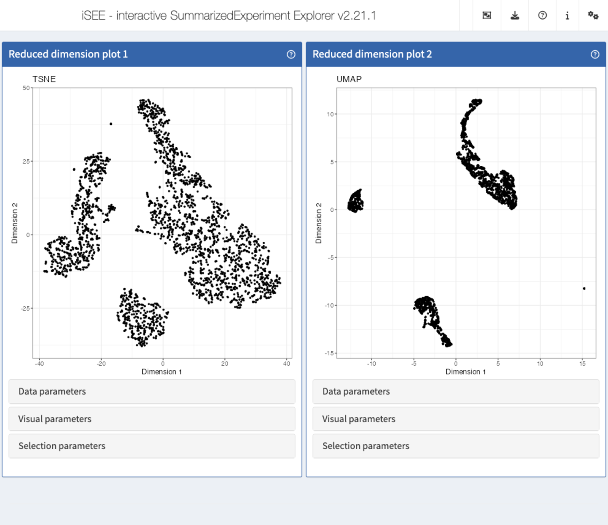

### Recipe 4: Data parameters configuration - displaying the expression of a specific gene across clusters

Using the `pbmc3k` data set, plot the distribution of the logcount
values for the gene `CD74` in each of the clusters.

Hints

- Gene expression values can be displayed using a `FeatureAssayPlot`
  panel.
- To select a gene, specify the ID provided as row names in the
  SingleCellExperiment.

Solution (interactively)

- First open an application with a `FeatureAssayPlot` panel, spanning
  the full application window)
  \
  `app`` ``<-`` `[`iSEE`](https://isee.github.io/iSEE/reference/iSEE.html)`(``sce``, initial ``=`` `[`list`](https://rdrr.io/r/base/list.html)`(`[`FeatureAssayPlot`](https://isee.github.io/iSEE/reference/FeatureAssayPlot-class.html)`(``PanelWidth ``=`` ``12L``)``)``)`\
  `shiny``::`[`runApp`](https://rdrr.io/pkg/shiny/man/runApp.html)`(``app``)`
- In the `FeatureAssayPlot` panel, click to expand the `Data parameters`
  collapsible box.
- Under `Y-axis feature`, type or select `CD74`.
- Under `X-axis`, select `Column data`, and under
  `Column of interest (X-axis)`, select `Cluster`.

Solution (programmatically)

\
`app`` ``<-`` `[`iSEE`](https://isee.github.io/iSEE/reference/iSEE.html)`(``sce``, initial ``=`` `[`list`](https://rdrr.io/r/base/list.html)`(`\
`  `[`FeatureAssayPlot`](https://isee.github.io/iSEE/reference/FeatureAssayPlot-class.html)`(`\
`    PanelWidth ``=`` ``12L``, XAxis ``=`` ``"Column data"``,`\
`    YAxisFeatureName ``=`` ``"CD74"``, XAxisColumnData ``=`` ``"Cluster"`\
`  ``)`\
`)``)`

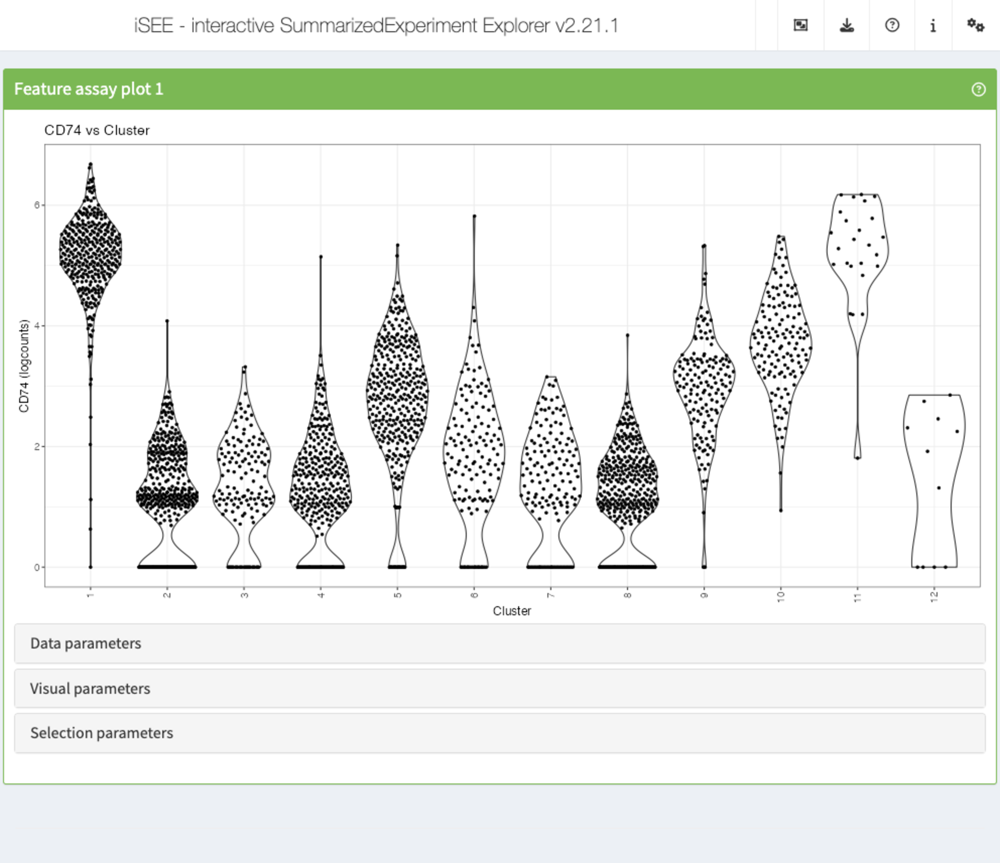

### Recipe 5: Visual parameters configuration - coloring reduced dimension representations by cell annotation

Using the `pbmc3k` data set, display two tSNE representations next to
each other. In the first one, color the cells by the cluster label. In
the second one, color the cells by the log10 of the total UMI count
(`log10_total` column of `colData(sce)`).

Hints

- Reduced dimension representations can be displayed using
  `ReducedDimensionPlot` panels.
- The reduced dimension representations in the SingleCellExperiment
  object can be accessed by name (`reducedDimNames(sce)` lists the
  available representations).
- The cluster labels are available in the `Cluster` column of
  `colData(sce)`.
- Point attributes can be accessed in the `Visual parameters`
  collapsible box. To display or hide the possible options, check the
  corresponding checkboxes (`Color`, `Shape`, `Size`, `Point`).

Solution (interactively)

- First open an application with two `ReducedDimensionPlot` panels, each
  spanning half the application window)
  \
  `app`` ``<-`` `[`iSEE`](https://isee.github.io/iSEE/reference/iSEE.html)`(``sce``, initial ``=`` `[`list`](https://rdrr.io/r/base/list.html)`(`\
  `  `[`ReducedDimensionPlot`](https://isee.github.io/iSEE/reference/ReducedDimensionPlot-class.html)`(``PanelWidth ``=`` ``6L``)``,`\
  `  `[`ReducedDimensionPlot`](https://isee.github.io/iSEE/reference/ReducedDimensionPlot-class.html)`(``PanelWidth ``=`` ``6L``)`\
  `)``)`\
  `shiny``::`[`runApp`](https://rdrr.io/pkg/shiny/man/runApp.html)`(``app``)`
- In each `ReducedDimensionPlot` panel, click to expand the
  `Data parameters` collapsible box and under `Type`, choose `TSNE`.
- In the first `ReducedDimensionPlot` panel, click to expand the
  `Visual parameters` collapsible box.
- Make sure that the `Color` checkbox is ticked.
- Under `Color by`, select `Column data`.
- In the dropdown menu that appears, select `Cluster`.
- In the second `ReducedDimensionPlot` panel, repeat the procedure but
  instead select `log10_total`.

Solution (programmatically)

\
`app`` ``<-`` `[`iSEE`](https://isee.github.io/iSEE/reference/iSEE.html)`(``sce``, initial ``=`` `[`list`](https://rdrr.io/r/base/list.html)`(`\
`  `[`ReducedDimensionPlot`](https://isee.github.io/iSEE/reference/ReducedDimensionPlot-class.html)`(`\
`    PanelWidth ``=`` ``6L``, Type ``=`` ``"TSNE"``,`\
`    ColorBy ``=`` ``"Column data"``,`\
`    ColorByColumnData ``=`` ``"Cluster"`\
`  ``)``,`\
`  `[`ReducedDimensionPlot`](https://isee.github.io/iSEE/reference/ReducedDimensionPlot-class.html)`(`\
`    PanelWidth ``=`` ``6L``, Type ``=`` ``"TSNE"``,`\
`    ColorBy ``=`` ``"Column data"``,`\
`    ColorByColumnData ``=`` ``"log10_total"`\
`  ``)`\
`)``)`

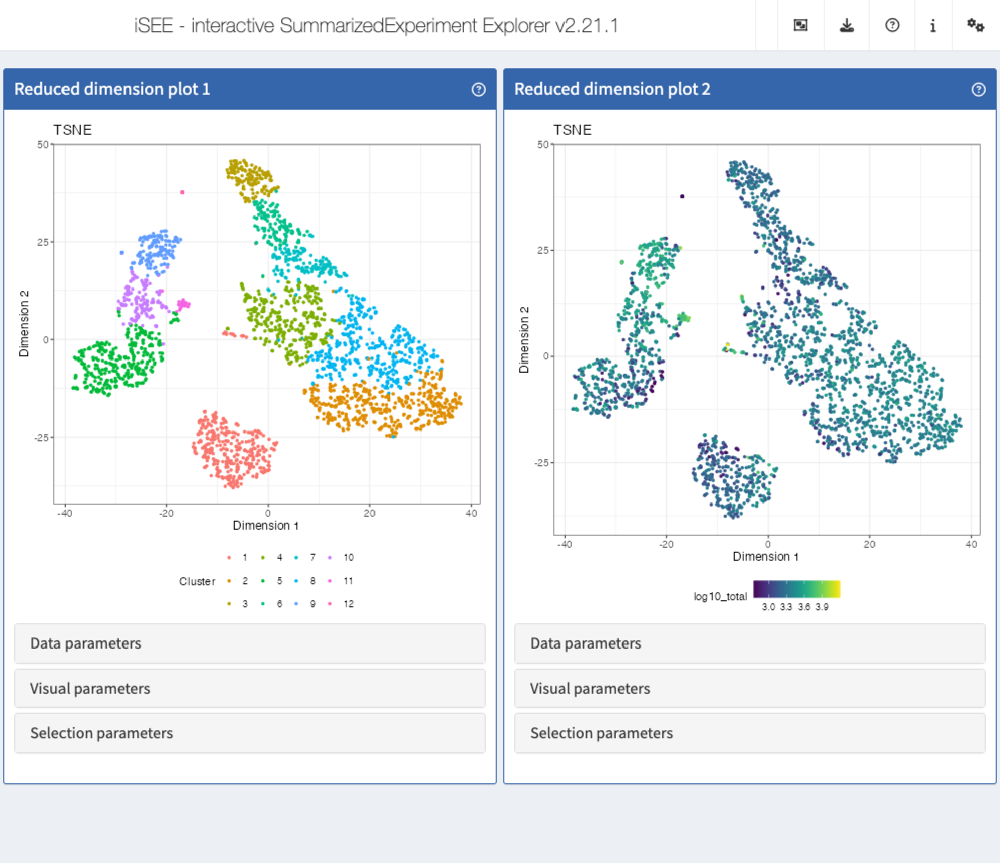

### Recipe 6: Visual parameters configuration - coloring reduced dimension representations by gene expression

Using the `pbmc3k` data set, display two tSNE representations next to
each other. In the first one, color the cells by the logcounts
expression level of `CD3D`. In the second one, color the cells by the
logcounts expression level of `CD79B`.

Hints

- Reduced dimension representations can be displayed using
  `ReducedDimensionPlot` panels.
- The reduced dimension representations in the SingleCellExperiment
  object can be accessed by name (`reducedDimNames(sce)` lists the
  available representations).
- To select a gene, specify the ID provided as row names in the
  SingleCellExperiment.
- Point attributes can be accessed in the `Visual parameters`
  collapsible box. To display or hide the possible options, check the
  corresponding checkboxes (`Color`, `Shape`, `Size`, `Point`).

Solution (interactively)

- First open an application with two `ReducedDimensionPlot` panels, each
  spanning half the application window)
  \
  `app`` ``<-`` `[`iSEE`](https://isee.github.io/iSEE/reference/iSEE.html)`(``sce``, initial ``=`` `[`list`](https://rdrr.io/r/base/list.html)`(`\
  `  `[`ReducedDimensionPlot`](https://isee.github.io/iSEE/reference/ReducedDimensionPlot-class.html)`(``PanelWidth ``=`` ``6L``)``,`\
  `  `[`ReducedDimensionPlot`](https://isee.github.io/iSEE/reference/ReducedDimensionPlot-class.html)`(``PanelWidth ``=`` ``6L``)`\
  `)``)`\
  `shiny``::`[`runApp`](https://rdrr.io/pkg/shiny/man/runApp.html)`(``app``)`
- In each `ReducedDimensionPlot` panel, click to expand the
  `Data parameters` collapsible box and under `Type`, choose `TSNE`.
- In the first `ReducedDimensionPlot` panel, click to expand the
  `Visual parameters` collapsible box.
- Make sure that the `Color` checkbox is ticked.
- Under `Color by`, select `Feature name`.
- In the dropdown menu that appears, select or type `CD3D`.
- In the second `ReducedDimensionPlot` panel, repeat the procedure but
  instead select `CD79B`.

Solution (programmatically)

\
`app`` ``<-`` `[`iSEE`](https://isee.github.io/iSEE/reference/iSEE.html)`(``sce``, initial ``=`` `[`list`](https://rdrr.io/r/base/list.html)`(`\
`  `[`ReducedDimensionPlot`](https://isee.github.io/iSEE/reference/ReducedDimensionPlot-class.html)`(`\
`    PanelWidth ``=`` ``6L``, Type ``=`` ``"TSNE"``,`\
`    ColorBy ``=`` ``"Feature name"``,`\
`    ColorByFeatureName ``=`` ``"CD3D"`\
`  ``)``,`\
`  `[`ReducedDimensionPlot`](https://isee.github.io/iSEE/reference/ReducedDimensionPlot-class.html)`(`\
`    PanelWidth ``=`` ``6L``, Type ``=`` ``"TSNE"``,`\
`    ColorBy ``=`` ``"Feature name"``,`\
`    ColorByFeatureName ``=`` ``"CD79B"`\
`  ``)`\
`)``)`

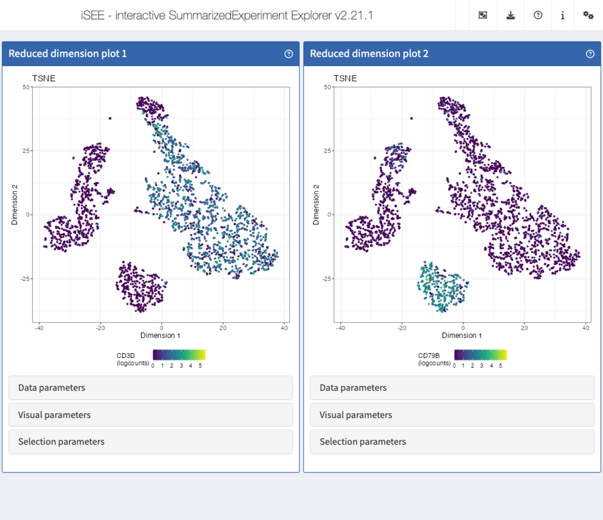

### Recipe 7: Visual parameters configuration - changing the size and opacity of points

Using the `pbmc3k` data set, display two tSNE representations next to
each other. In the first one, set the point size to 0.5. In the second
one, set the point size to 3 and the opacity to 0.2.

Hints

- Reduced dimension representations can be displayed using
  `ReducedDimensionPlot` panels.
- The reduced dimension representations in the SingleCellExperiment
  object can be accessed by name (`reducedDimNames(sce)` lists the
  available representations).
- Point attributes can be accessed in the `Visual parameters`
  collapsible box. To display or hide the possible options, check the
  corresponding checkboxes (`Color`, `Shape`, `Size`, `Point`).

Solution (interactively)

- First open an application with two `ReducedDimensionPlot` panels, each
  spanning half the application window)
  \
  `app`` ``<-`` `[`iSEE`](https://isee.github.io/iSEE/reference/iSEE.html)`(``sce``, initial ``=`` `[`list`](https://rdrr.io/r/base/list.html)`(`\
  `  `[`ReducedDimensionPlot`](https://isee.github.io/iSEE/reference/ReducedDimensionPlot-class.html)`(``PanelWidth ``=`` ``6L``)``,`\
  `  `[`ReducedDimensionPlot`](https://isee.github.io/iSEE/reference/ReducedDimensionPlot-class.html)`(``PanelWidth ``=`` ``6L``)`\
  `)``)`\
  `shiny``::`[`runApp`](https://rdrr.io/pkg/shiny/man/runApp.html)`(``app``)`
- In each `ReducedDimensionPlot` panel, click to expand the
  `Data parameters` collapsible box and under `Type`, choose `TSNE`.
- In the first `ReducedDimensionPlot` panel, click to expand the
  `Visual parameters` collapsible box.
- Make sure that the `Size` checkbox is ticked.
- Under `Size by`, select `None`.
- In the text box underneath, type 0.5.
- In the second `ReducedDimensionPlot` panel, click to expand the
  `Visual parameters` collapsible box.
- Make sure that the `Size` and `Point` checkboxes are ticked.
- Under `Size by`, select `None`.
- In the text box underneath, type 3.
- Under `Point opacity`, drag the slider to 0.2.

Solution (programmatically)

\
`app`` ``<-`` `[`iSEE`](https://isee.github.io/iSEE/reference/iSEE.html)`(``sce``, initial ``=`` `[`list`](https://rdrr.io/r/base/list.html)`(`\
`  `[`ReducedDimensionPlot`](https://isee.github.io/iSEE/reference/ReducedDimensionPlot-class.html)`(`\
`    PanelWidth ``=`` ``6L``, Type ``=`` ``"TSNE"``,`\
`    PointSize ``=`` ``0.5`\
`  ``)``,`\
`  `[`ReducedDimensionPlot`](https://isee.github.io/iSEE/reference/ReducedDimensionPlot-class.html)`(`\
`    PanelWidth ``=`` ``6L``, Type ``=`` ``"TSNE"``,`\
`    PointSize ``=`` ``3``, PointAlpha ``=`` ``0.2`\
`  ``)`\
`)``)`

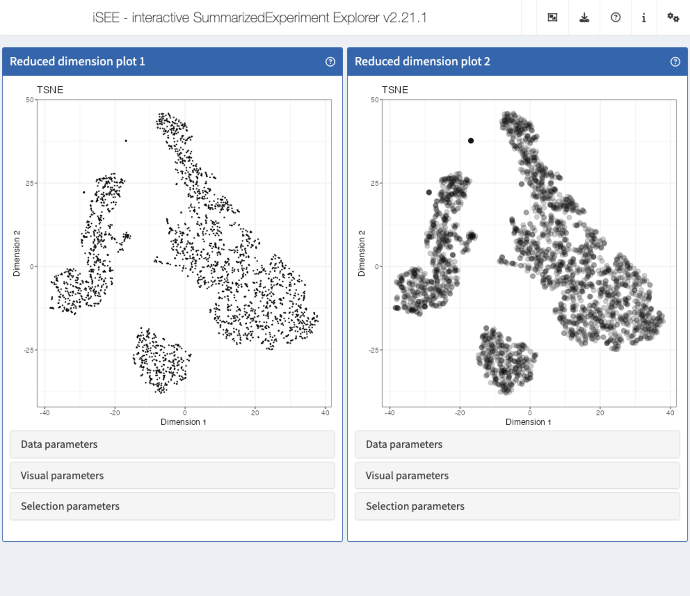

### Recipe 8: Selection configuration

Using the `pbmc3k` data set, display the expression (logcounts) of
`CD3D` across the assigned clusters, as well as a tSNE representation
colored by the cluster label. Select all cells with a logcount
expression value of `CD3D` between (approximately) 0.5 and 4, and
highlight these in the tSNE plot by means of transparency.

Hints

- Reduced dimension representations can be displayed using
  `ReducedDimensionPlot` panels.
- The reduced dimension representations in the SingleCellExperiment
  object can be accessed by name (`reducedDimNames(sce)` lists the
  available representations).
- Gene expression values can be displayed using a `FeatureAssayPlot`
  panel.
- To select a gene, specify the ID provided as row names in the
  SingleCellExperiment.
- Transmission of selections is set up in the `Selection parameters`
  collapsible box.
- Points can be selected by clicking and dragging the mouse to draw a
  rectangle around them, or by repeatedly clicking to make a lasso
  (free-form) selection.

Solution (interactively)

- First open an application with one `FeatureAssayPlot` panel and one
  `ReducedDimensionPlot` panel, each spanning half the application
  window)
  \
  `app`` ``<-`` `[`iSEE`](https://isee.github.io/iSEE/reference/iSEE.html)`(``sce``, initial ``=`` `[`list`](https://rdrr.io/r/base/list.html)`(`\
  `  `[`FeatureAssayPlot`](https://isee.github.io/iSEE/reference/FeatureAssayPlot-class.html)`(``PanelWidth ``=`` ``6L``)``,`\
  `  `[`ReducedDimensionPlot`](https://isee.github.io/iSEE/reference/ReducedDimensionPlot-class.html)`(``PanelWidth ``=`` ``6L``)`\
  `)``)`\
  `shiny``::`[`runApp`](https://rdrr.io/pkg/shiny/man/runApp.html)`(``app``)`
- In the `FeatureAssayPlot` panel, click to expand the `Data parameters`
  collapsible box and under `Y-axis feature`, type or select `CD3D`.
- Under `X-axis`, select `Column data`, and under `X-axis column data`,
  select `Cluster`.
- In the `FeatureAssayPlot` panel, use the mouse to drag a rectangle
  around all points with a logcount expression value (y-axis) between
  approximately 0.5 and 4.
- In the `ReducedDimensionPlot` panel, click to expand the
  `Data parameters` collapsible box and under `Type`, choose `TSNE`.
- In the `ReducedDimensionPlot` panel, further click to expand the
  `Visual parameters` collapsible box, make sure that the `Color`
  checkbox is ticked. Under `Color by`, select `Column data`. In the
  dropdown menu that appears, type or select `Cluster`.
- In the `ReducedDimensionPlot` panel, click to expand the
  `Selection parameters` collapsible box.
- Under `Receive column selection from`, select `Feature assay plot 1`.

Solution (programmatically)

\
`app`` ``<-`` `[`iSEE`](https://isee.github.io/iSEE/reference/iSEE.html)`(``sce``, initial ``=`` `[`list`](https://rdrr.io/r/base/list.html)`(`\
`  `[`FeatureAssayPlot`](https://isee.github.io/iSEE/reference/FeatureAssayPlot-class.html)`(`\
`    PanelWidth ``=`` ``6L``,`\
`    BrushData ``=`` `[`list`](https://rdrr.io/r/base/list.html)`(`\
`      xmin ``=`` ``0``, xmax ``=`` ``15``,`\
`      ymin ``=`` ``0.5``, ymax ``=`` ``4``,`\
`      mapping ``=`` `[`list`](https://rdrr.io/r/base/list.html)`(``x ``=`` ``"X"``, y ``=`` ``"Y"``, group ``=`` ``"GroupBy"``)``,`\
`      direction ``=`` ``"xy"``,`\
`      brushId ``=`` ``"FeatureAssayPlot1_Brush"``,`\
`      outputId ``=`` ``"FeatureAssayPlot1"`\
`    ``)``,`\
`    XAxis ``=`` ``"Column data"``,`\
`    XAxisColumnData ``=`` ``"Cluster"``, YAxisFeatureName ``=`` ``"CD3D"`\
`  ``)``,`\
`  `[`ReducedDimensionPlot`](https://isee.github.io/iSEE/reference/ReducedDimensionPlot-class.html)`(`\
`    PanelWidth ``=`` ``6L``, Type ``=`` ``"TSNE"``,`\
`    ColorBy ``=`` ``"Column data"``,`\
`    ColorByColumnData ``=`` ``"Cluster"``,`\
`    ColumnSelectionRestrict ``=`` ``FALSE``,`\
`    ColumnSelectionSource ``=`` ``"FeatureAssayPlot1"`\
`  ``)`\
`)``)`

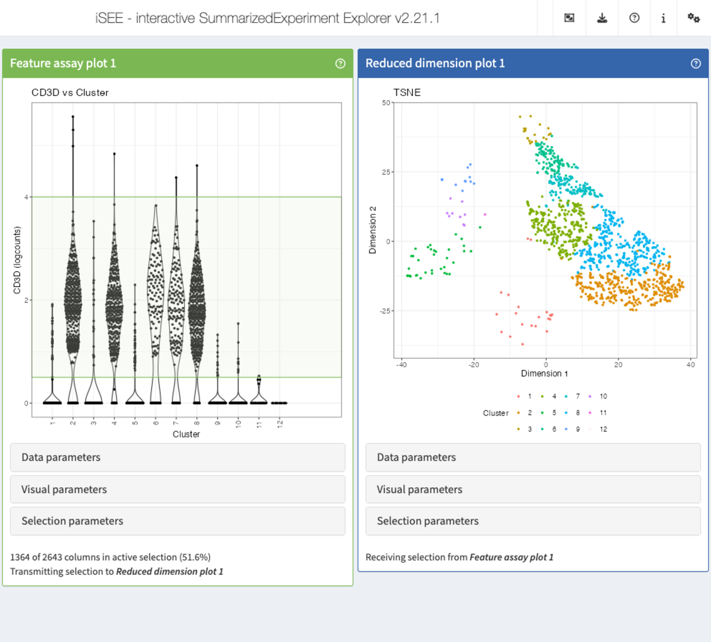

### Recipe 9: Verifying the cell type identity of clusters

Using the `pbmc3k` data set, create a scatter plots displaying the
(logcounts) expression values of `CD79A` vs `CD74`, as well as a Hinton
plot of the cluster and cell type assignment annotations. Select the
cells co-expressing `CD79A` and `CD74` in the scatter plot. Which cell
type/cluster(s) do these correspond to (color these points in the Hinton
plot)?

Hints

- Gene expression values can be displayed using a `FeatureAssayPlot`
  panel.
- To select a gene, specify the ID provided as row names in the
  SingleCellExperiment.
- Column (in this case cell) annotations can be visualized using a
  `ColumnDataPlot` panel.
- The cluster labels are available in the `Cluster` column of
  `colData(sce)`. Coarse-grained cell type labels are available in the
  `labels_main` column.
- Transmission of selections is set up in the `Selection parameters`
  collapsible box.
- Points can be selected by clicking and dragging the mouse to draw a
  rectangle around them, or by repeatedly clicking to make a lasso
  (free-form) selection.

Solution (interactively)

- First open an application with one `FeatureAssayPlot` panel and one
  `ColumnDataPlot` panel, each spanning half of the application window)
  \
  `app`` ``<-`` `[`iSEE`](https://isee.github.io/iSEE/reference/iSEE.html)`(``sce``, initial ``=`` `[`list`](https://rdrr.io/r/base/list.html)`(`\
  `  `[`FeatureAssayPlot`](https://isee.github.io/iSEE/reference/FeatureAssayPlot-class.html)`(``PanelWidth ``=`` ``6L``)``,`\
  `  `[`ColumnDataPlot`](https://isee.github.io/iSEE/reference/ColumnDataPlot-class.html)`(``PanelWidth ``=`` ``6L``)`\
  `)``)`\
  `shiny``::`[`runApp`](https://rdrr.io/pkg/shiny/man/runApp.html)`(``app``)`
- In the `FeatureAssayPlot` panel, click to expand the `Data parameters`
  collapsible box.
- Under `Y-axis feature`, type or select `CD79A`.
- Under `X-axis`, select `Feature name`, and under `X-axis feature`,
  type or select `CD74`.
- In the `ColumnDataPlot` panel, click to expand the `Data parameters`
  collapsible box.
- Under `Column of interest (Y-axis)`, type or select `labels_main`.
- Under `X-axis`, select `Column data`, and under
  `Column of interest (X-axis)`, select `Cluster`.
- In the `FeatureAssayPlot` panel, use the mouse to drag a rectangle
  around all points co-expressing `CD79A` and `CD74`.
- In the `ColumnDataPlot` panel, click to expand the
  `Selection parameters` collapsible box.
- Under `Receive column selection from`, select `Feature assay plot 1`.
- In the `ColumnDataPlot` panel, click to expand the `Visual parameters`
  collapsible box, make sure that the `Color` checkbox is ticked.
- Under `Color by:`, select `Column selection`.

Solution (programmatically)

\
`app`` ``<-`` `[`iSEE`](https://isee.github.io/iSEE/reference/iSEE.html)`(``sce``, initial ``=`` `[`list`](https://rdrr.io/r/base/list.html)`(`\
`  `[`FeatureAssayPlot`](https://isee.github.io/iSEE/reference/FeatureAssayPlot-class.html)`(`\
`    PanelWidth ``=`` ``6L``, XAxis ``=`` ``"Feature name"``,`\
`    YAxisFeatureName ``=`` ``"CD79A"``,`\
`    XAxisFeatureName ``=`` ``"CD74"``,`\
`    BrushData ``=`` `[`list`](https://rdrr.io/r/base/list.html)`(`\
`      xmin ``=`` ``0.3``, xmax ``=`` ``7``,`\
`      ymin ``=`` ``0.3``, ymax ``=`` ``7``,`\
`      mapping ``=`` `[`list`](https://rdrr.io/r/base/list.html)`(``x ``=`` ``"X"``, y ``=`` ``"Y"``, colour ``=`` ``"ColorBy"``)``,`\
`      direction ``=`` ``"xy"``, brushId ``=`` ``"FeatureAssayPlot1_Brush"``,`\
`      outputId ``=`` ``"FeatureAssayPlot1"`\
`    ``)`\
`  ``)``,`\
`  `[`ColumnDataPlot`](https://isee.github.io/iSEE/reference/ColumnDataPlot-class.html)`(`\
`    PanelWidth ``=`` ``6L``, XAxis ``=`` ``"Column data"``,`\
`    YAxis ``=`` ``"labels_main"``,`\
`    XAxisColumnData ``=`` ``"Cluster"``,`\
`    ColumnSelectionSource ``=`` ``"FeatureAssayPlot1"``,`\
`    ColumnSelectionRestrict ``=`` ``FALSE``,`\
`    ColorBy ``=`` ``"Column selection"`\
`  ``)`\
`)``)`

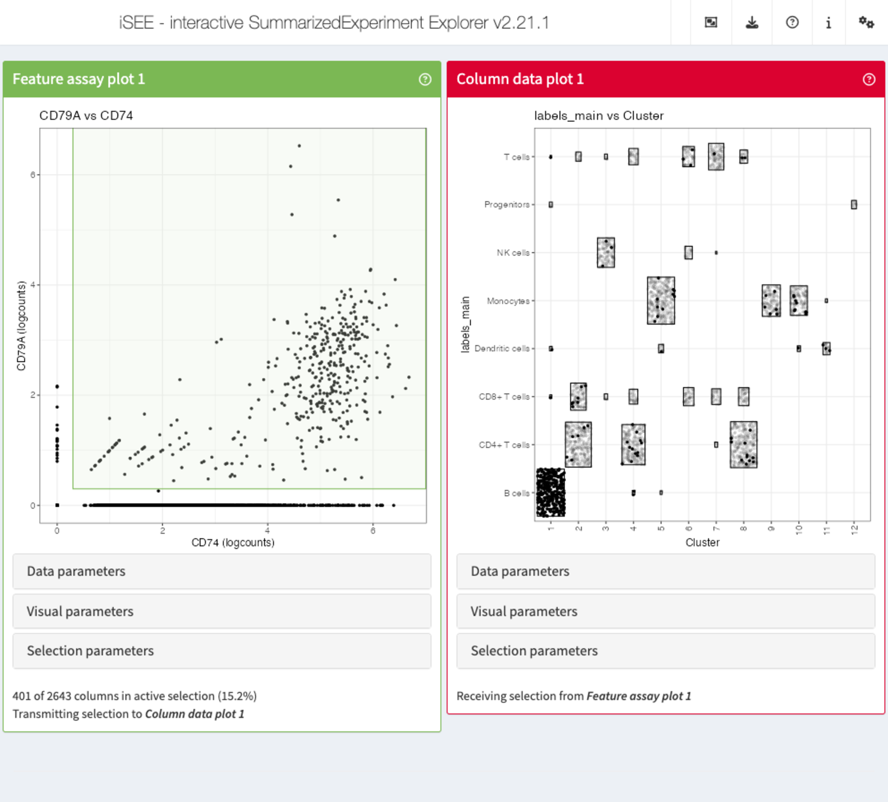

### Recipe 10: Using modes from `iSEEu`

Using the `pbmc3k` data set, load `iSEEu` and use the `modeReducedDim`
mode to open an app displaying all the reduced dimension representations
stored in the SingleCellExperiment object. Color the representations by
the cell type assignment.

Hints

- The cell type assignments are available in the `labels_fine` column of
  `colData(sce)` (more coarse-grained assignments are provided in the
  `labels_main` column).
- The annotation to color by can be specified when calling
  [`iSEEu::modeReducedDim()`](https://rdrr.io/pkg/iSEEu/man/modeReducedDim.html).

Solution (programmatically)

\
`app`` ``<-`` `[`modeReducedDim`](https://rdrr.io/pkg/iSEEu/man/modeReducedDim.html)`(``sce``, colorBy ``=`` ``"labels_main"``)`

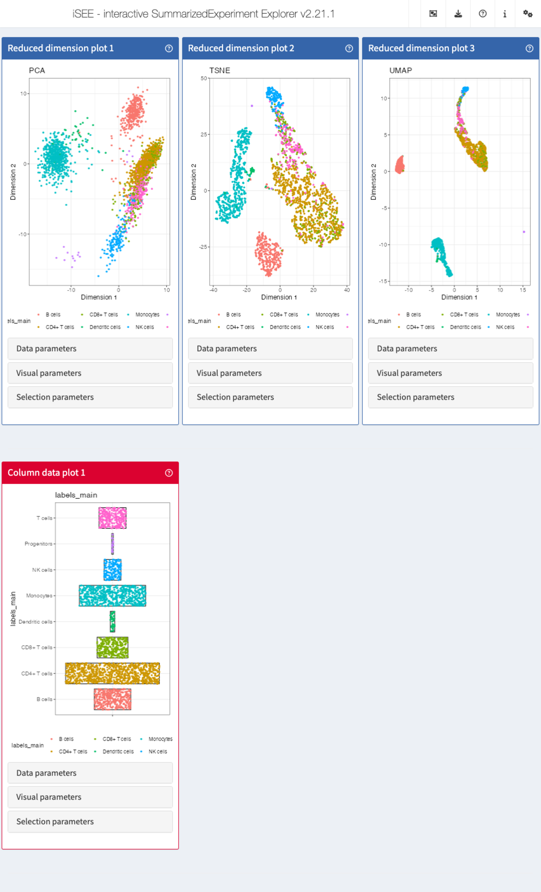

### Recipe 11 - Including a tour

Using the `pbmc3k` data set, display two tSNE representations next to
each other. In the first one, color the cells by the logcounts
expression level of `CD3D`. In the second one, color the cells by the
logcounts expression level of `CD79B`. Also include a small tour that
starts with a welcome message, next walks through the two panels, giving
an informative message for each, and finally ends with a concluding
message to the user.

Hints

- Reduced dimension representations can be displayed using
  `ReducedDimensionPlot` panels.
- The reduced dimension representations in the SingleCellExperiment
  object can be accessed by name (`reducedDimNames(sce)` lists the
  available representations).
- To select a gene, specify the ID provided as row names in the
  SingleCellExperiment.
- Point attributes can be accessed in the `Visual parameters`
  collapsible box. To display or hide the possible options, check the
  corresponding checkboxes (`Color`, `Shape`, `Size`, `Point`).
- Tours are provided via the `tour` argument to
  [`iSEE()`](https://isee.github.io/iSEE/reference/iSEE.html).
- A tour is defined by a two-column data frame, with columns named
  `element` and `intro`. The `element` column contains the names of UI
  elements, prefixed by a hash sign. More details, including how to find
  the name of a particular UI elements, can be found in the
  `Configuring iSEE apps` vignette of `iSEE`.

Solution (programmatically)

\
`tour`` ``<-`` `[`data.frame`](https://rdrr.io/r/base/data.frame.html)`(`\
`  element ``=`` `[`c`](https://rdrr.io/r/base/c.html)`(`\
`    ``"#Welcome"``,`\
`    ``"#ReducedDimensionPlot1"``,`\
`    ``"#ReducedDimensionPlot2"``,`\
`    ``"#Conclusion"`\
`  ``)``,`\
`  intro ``=`` `[`c`](https://rdrr.io/r/base/c.html)`(`\
`    ``"Welcome to this tour!"``,`\
`    ``"This is the first reduced dimension plot"``,`\
`    ``"And here is the second one"``,`\
`    ``"Thank you for taking this tour!"`\
`  ``)``,`\
`  stringsAsFactors ``=`` ``FALSE`\
`)`\
\
`app`` ``<-`` `[`iSEE`](https://isee.github.io/iSEE/reference/iSEE.html)`(``sce``,`\
`  initial ``=`` `[`list`](https://rdrr.io/r/base/list.html)`(`\
`    `[`ReducedDimensionPlot`](https://isee.github.io/iSEE/reference/ReducedDimensionPlot-class.html)`(`\
`      PanelWidth ``=`` ``6L``, Type ``=`` ``"TSNE"``,`\
`      ColorBy ``=`` ``"Feature name"``,`\
`      ColorByFeatureName ``=`` ``"CD3D"`\
`    ``)``,`\
`    `[`ReducedDimensionPlot`](https://isee.github.io/iSEE/reference/ReducedDimensionPlot-class.html)`(`\
`      PanelWidth ``=`` ``6L``, Type ``=`` ``"TSNE"``,`\
`      ColorBy ``=`` ``"Feature name"``,`\
`      ColorByFeatureName ``=`` ``"CD79B"`\
`    ``)`\
`  ``)``,`\
`  tour ``=`` ``tour`\
`)`

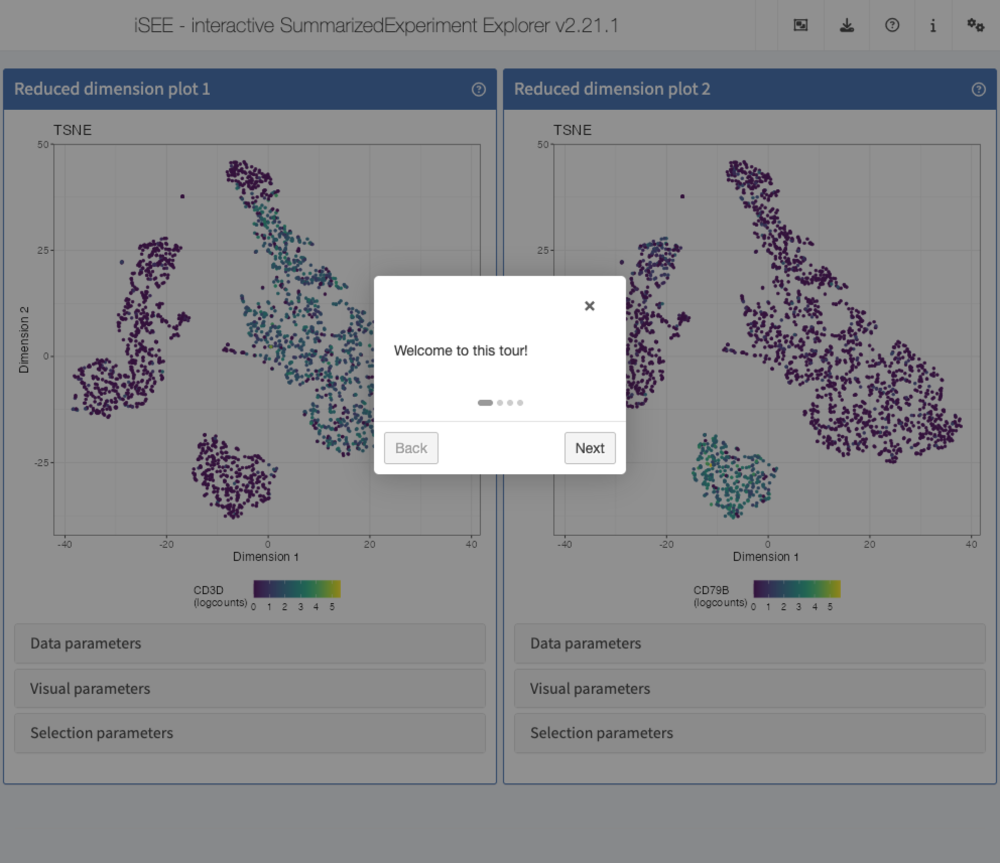

## Session info

**Session info**

\
[`sessionInfo`](https://rdrr.io/r/utils/sessionInfo.html)`(``)`\
`#> R version 4.6.1 (2026-06-24)`\
`#> Platform: x86_64-pc-linux-gnu`\
`#> Running under: Ubuntu 24.04.5 LTS`\
`#> `\
`#> Matrix products: default`\
`#> BLAS:   /usr/lib/x86_64-linux-gnu/openblas-pthread/libblas.so.3 `\
`#> LAPACK: /usr/lib/x86_64-linux-gnu/openblas-pthread/libopenblasp-r0.3.26.so;  LAPACK version 3.12.0`\
`#> `\
`#> locale:`\
`#>  [1] LC_CTYPE=en_US.UTF-8       LC_NUMERIC=C              `\
`#>  [3] LC_TIME=en_US.UTF-8        LC_COLLATE=en_US.UTF-8    `\
`#>  [5] LC_MONETARY=en_US.UTF-8    LC_MESSAGES=en_US.UTF-8   `\
`#>  [7] LC_PAPER=en_US.UTF-8       LC_NAME=C                 `\
`#>  [9] LC_ADDRESS=C               LC_TELEPHONE=C            `\
`#> [11] LC_MEASUREMENT=en_US.UTF-8 LC_IDENTIFICATION=C       `\
`#> `\
`#> time zone: Etc/UTC`\
`#> tzcode source: system (glibc)`\
`#> `\
`#> attached base packages:`\
`#> [1] stats4    stats     graphics  grDevices utils     datasets  methods  `\
`#> [8] base     `\
`#> `\
`#> other attached packages:`\
`#>  [1] iSEEu_1.24.0                iSEEhex_1.14.0             `\
`#>  [3] iSEE_2.24.0                 SingleCellExperiment_1.34.0`\
`#>  [5] SummarizedExperiment_1.42.0 Biobase_2.72.0             `\
`#>  [7] GenomicRanges_1.64.0        Seqinfo_1.2.0              `\
`#>  [9] IRanges_2.46.0              S4Vectors_0.50.3           `\
`#> [11] BiocGenerics_0.58.1         generics_0.1.4             `\
`#> [13] MatrixGenerics_1.24.0       matrixStats_1.5.0          `\
`#> [15] BiocStyle_2.40.0           `\
`#> `\
`#> loaded via a namespace (and not attached):`\
`#>  [1] rlang_1.3.0           magrittr_2.0.5        shinydashboard_0.7.3 `\
`#>  [4] clue_0.3-68           GetoptLong_1.1.1      otel_0.2.0           `\
`#>  [7] compiler_4.6.1        mgcv_1.9-4            png_0.1-9            `\
`#> [10] systemfonts_1.3.2     vctrs_0.7.3           pkgconfig_2.0.3      `\
`#> [13] shape_1.4.6.1         crayon_1.5.3          fastmap_1.2.0        `\
`#> [16] XVector_0.52.0        fontawesome_0.5.3     promises_1.5.0       `\
`#> [19] rmarkdown_2.32        shinyAce_0.4.4        ragg_1.5.2           `\
`#> [22] xfun_0.62             cachem_1.1.0          jsonlite_2.0.0       `\
`#> [25] listviewer_4.0.0      later_1.4.8           DelayedArray_0.38.2  `\
`#> [28] parallel_4.6.1        cluster_2.1.8.3       R6_2.6.1             `\
`#> [31] bslib_0.12.0          RColorBrewer_1.1-3    jquerylib_0.1.4      `\
`#> [34] Rcpp_1.1.2            iterators_1.0.14      knitr_1.52           `\
`#> [37] httpuv_1.6.17         Matrix_1.7-6          splines_4.6.1        `\
`#> [40] igraph_2.3.4          tidyselect_1.2.1      abind_1.4-8          `\
`#> [43] yaml_2.3.12           doParallel_1.0.17     codetools_0.2-20     `\
`#> [46] miniUI_0.1.2          lattice_0.23-1        tibble_3.3.1         `\
`#> [49] shiny_1.14.0          S7_0.2.2              evaluate_1.0.5       `\
`#> [52] desc_1.4.3            circlize_0.4.18       pillar_1.11.1        `\
`#> [55] BiocManager_1.30.27   DT_0.34.0             foreach_1.5.2        `\
`#> [58] shinyjs_2.1.1         ggplot2_4.0.3         scales_1.4.0         `\
`#> [61] xtable_1.8-8          glue_1.8.1            tools_4.6.1          `\
`#> [64] hexbin_1.28.6         colourpicker_1.3.0    fs_2.1.0             `\
`#> [67] grid_4.6.1            colorspace_2.1-4      nlme_3.1-171         `\
`#> [70] vipor_0.4.7           cli_3.6.6             textshaping_1.0.5    `\
`#> [73] S4Arrays_1.12.1       viridisLite_0.4.3     ComplexHeatmap_2.28.0`\
`#> [76] dplyr_1.2.1           gtable_0.3.6          rintrojs_0.3.4       `\
`#> [79] sass_0.4.10           digest_0.6.39         SparseArray_1.12.3   `\
`#> [82] ggrepel_0.9.8         rjson_0.2.23          htmlwidgets_1.6.4    `\
`#> [85] farver_2.1.2          memoise_2.0.1         htmltools_0.5.9      `\
`#> [88] pkgdown_2.2.1         lifecycle_1.0.5       shinyWidgets_0.9.1   `\
`#> [91] GlobalOptions_0.1.4   mime_0.13`

## References

Rue-Albrecht, Kevin, Federico Marini, Charlotte Soneson, and Aaron T L
Lun. 2018. “iSEE: Interactive SummarizedExperiment Explorer.”
*F1000Res.* 7: 741.
