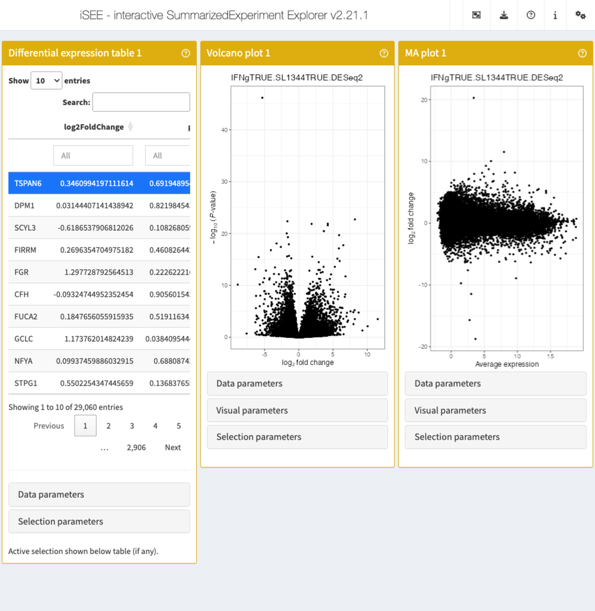
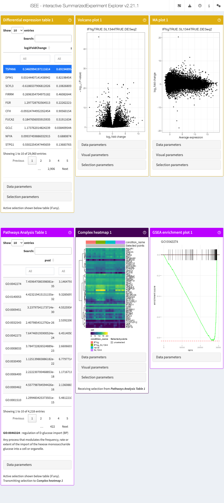
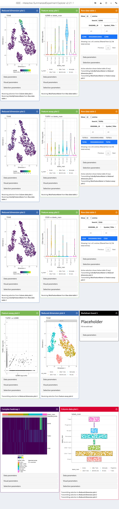
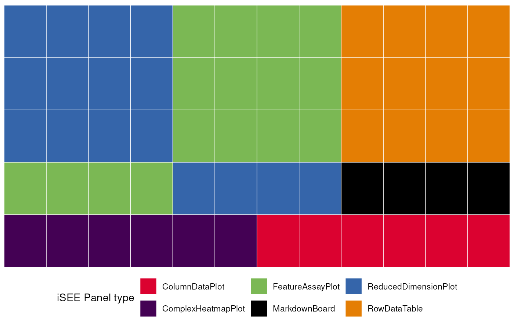
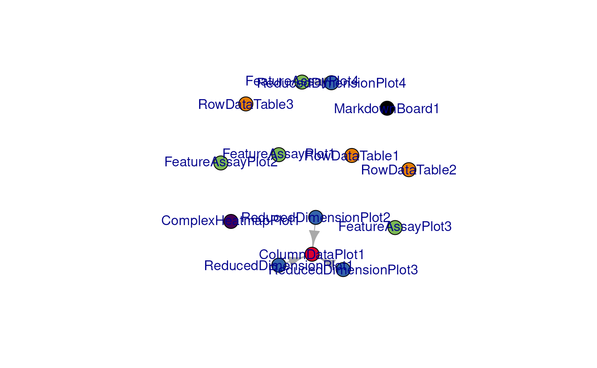
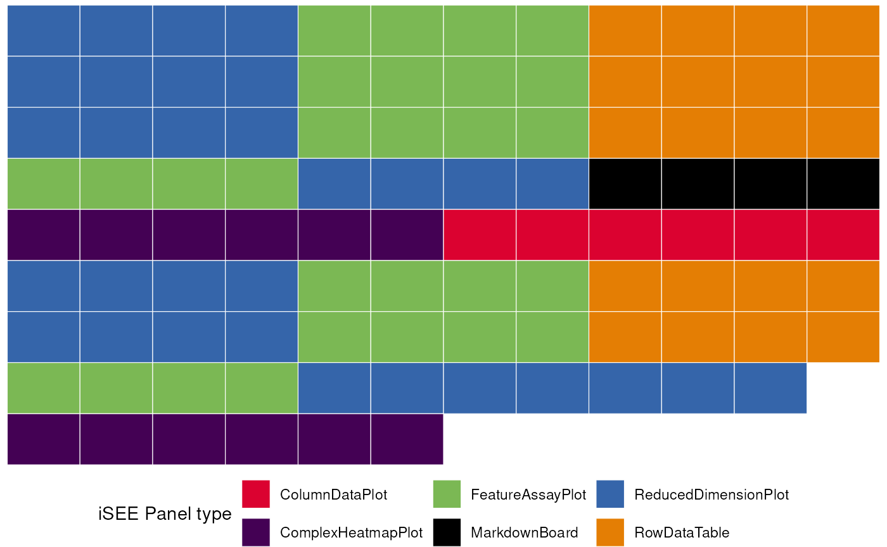
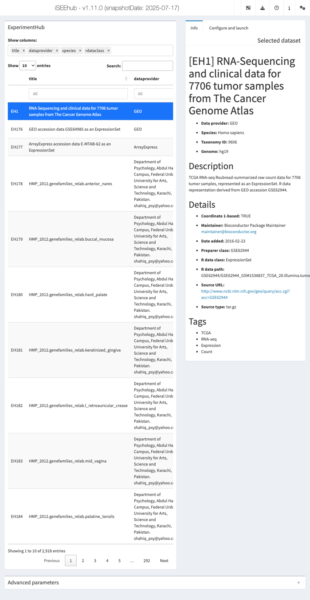
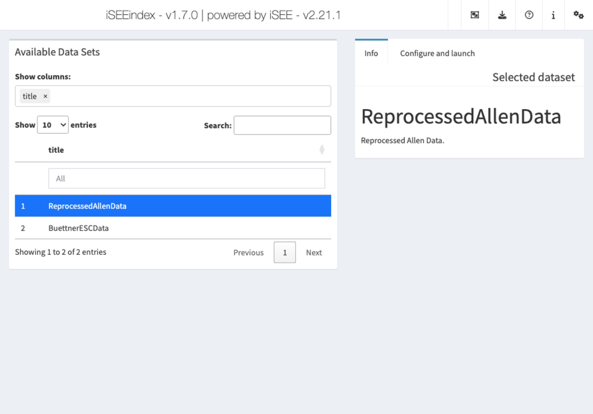
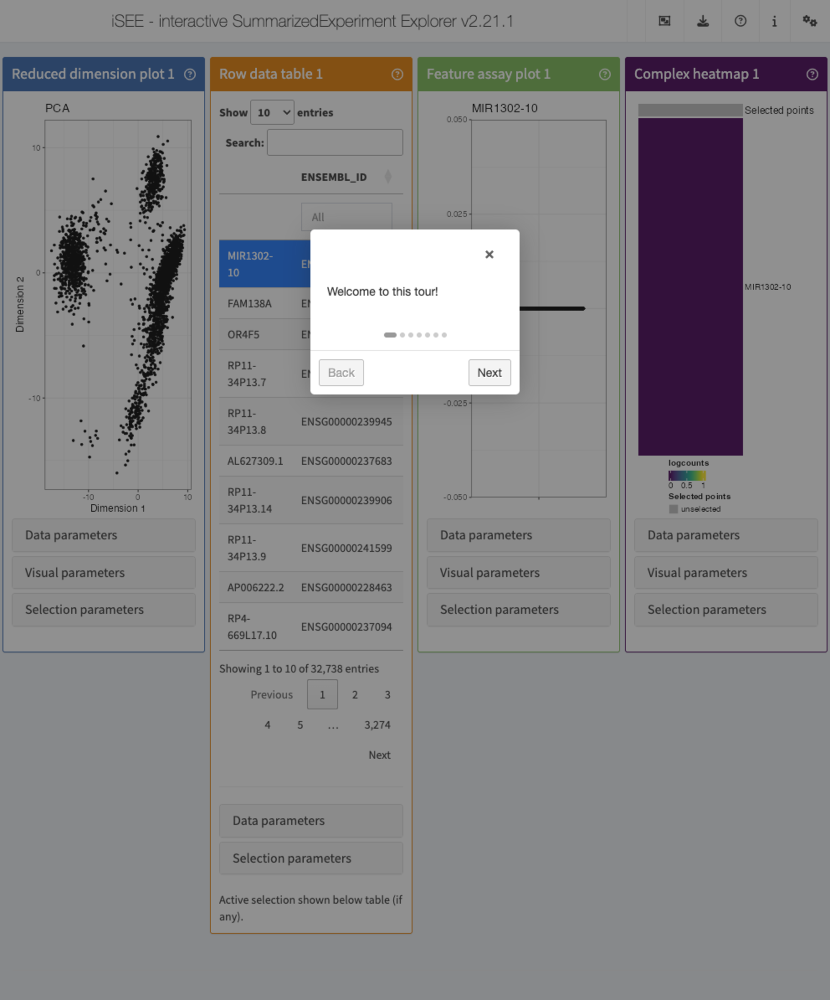

# Bonus content

## Introduction

This vignette contains some additional examples of things that can be
done using `iSEE`, going beyond the basic application interface.

## iSEEde and iSEEpathways

*[iSEEde](https://bioconductor.org/packages/3.23/iSEEde)* and
*[iSEEpathways](https://bioconductor.org/packages/3.23/iSEEpathways)*
are ideal companion packages for exploring differential expression
results in (e.g.) bulk RNA-seq data.

We will use the `macrophage` dataset (derived from the work of (Alasoo
et al. 2018)), for which we have already run a differential expression
analysis using `DESeq2` (Love et al. 2014). The processed dataset is
provided with the workshop package, and the processing code can be found
in the accompanying
[script](https://github.com/iSEE/iUSEiSEE/blob/main/inst/create_datasets.Rmd#L330).

\
`sce_macrophage`` ``<-`` `[`readRDS`](https://rdrr.io/r/base/readRDS.html)`(`\
`  `[`system.file`](https://rdrr.io/r/base/system.file.html)`(``"datasets"``, ``"sce_macrophage_readytouse.RDS"``,`\
`              package ``=`` ``"iUSEiSEE"``)`\
`)`\
\
[`library`](https://rdrr.io/r/base/library.html)`(`[`"iSEE"`](https://isee.github.io/iSEE/)`)`\
[`library`](https://rdrr.io/r/base/library.html)`(`[`"iSEEde"`](https://github.com/iSEE/iSEEde)`)`\
[`library`](https://rdrr.io/r/base/library.html)`(`[`"iSEEpathways"`](https://github.com/iSEE/iSEEpathways)`)`\
[`library`](https://rdrr.io/r/base/library.html)`(`[`"AnnotationDbi"`](https://bioconductor.org/packages/AnnotationDbi)`)`\
[`library`](https://rdrr.io/r/base/library.html)`(``"org.Hs.eg.db"``)`\
`#> `\
[`library`](https://rdrr.io/r/base/library.html)`(``"GO.db"``)`\
`#> `

*[iSEEde](https://bioconductor.org/packages/3.23/iSEEde)* and
*[iSEEpathways](https://bioconductor.org/packages/3.23/iSEEpathways)*
are two new Bioconductor packages that provide
*[iSEE](https://bioconductor.org/packages/3.23/iSEE)* panels
specifically aimed towards exploration of differential expression and
pathway analysis results. More precisely,
*[iSEEde](https://bioconductor.org/packages/3.23/iSEEde)* provides the
`VolcanoPlot`, `MAPlot`, `LogFCLogFCPlot` and `DETable` panels. These
panels can be configured to extract data that was added via the
[`embedContrastResults()`](https://rdrr.io/pkg/iSEEde/man/utils-SummarizedExperiment.html)
function (see the processing script).

Let’s look at an example:

\
`app`` ``<-`` `[`iSEE`](https://isee.github.io/iSEE/reference/iSEE.html)`(``sce_macrophage``, initial ``=`` `[`list`](https://rdrr.io/r/base/list.html)`(`\
`  ``iSEEde``::`[`DETable`](https://rdrr.io/pkg/iSEEde/man/DETable-class.html)`(`\
`    ContrastName ``=`` ``"IFNgTRUE.SL1344TRUE.DESeq2"``,`\
`    HiddenColumns ``=`` `[`c`](https://rdrr.io/r/base/c.html)`(``"baseMean"``, ``"lfcSE"``, ``"stat"``)`\
`  ``)``,`\
`  ``iSEEde``::`[`VolcanoPlot`](https://rdrr.io/pkg/iSEEde/man/VolcanoPlot-class.html)`(``ContrastName ``=`` ``"IFNgTRUE.SL1344TRUE.DESeq2"``)``,`\
`  ``iSEEde``::`[`MAPlot`](https://rdrr.io/pkg/iSEEde/man/MAPlot-class.html)`(``ContrastName ``=`` ``"IFNgTRUE.SL1344TRUE.DESeq2"``)`\
`)``)`

Note how it is easy to switch to a different contrast in any of the
panels.

\
`app`` ``<-`` `[`iSEE`](https://isee.github.io/iSEE/reference/iSEE.html)`(``sce_macrophage``, initial ``=`` `[`list`](https://rdrr.io/r/base/list.html)`(`\
`  ``iSEEde``::`[`DETable`](https://rdrr.io/pkg/iSEEde/man/DETable-class.html)`(`\
`    ContrastName ``=`` ``"IFNgTRUE.SL1344TRUE.DESeq2"``,`\
`    HiddenColumns ``=`` `[`c`](https://rdrr.io/r/base/c.html)`(``"baseMean"``, ``"lfcSE"``, ``"stat"``)`\
`  ``)``,`\
`  ``iSEEde``::`[`VolcanoPlot`](https://rdrr.io/pkg/iSEEde/man/VolcanoPlot-class.html)`(``ContrastName ``=`` ``"IFNgTRUE.SL1344TRUE.DESeq2"``)``,`\
`  ``iSEEde``::`[`MAPlot`](https://rdrr.io/pkg/iSEEde/man/MAPlot-class.html)`(``ContrastName ``=`` ``"IFNgTRUE.SL1344TRUE.DESeq2"``)``,`\
`  `[`PathwaysTable`](https://rdrr.io/pkg/iSEEpathways/man/PathwaysTable-class.html)`(`\
`    ResultName ``=`` ``"IFNgTRUE.SL1344TRUE.limma.fgsea"``,`\
`    Selected ``=`` ``"GO:0046324"`\
`  ``)``,`\
`  `[`ComplexHeatmapPlot`](https://isee.github.io/iSEE/reference/ComplexHeatmapPlot-class.html)`(`\
`    RowSelectionSource ``=`` ``"PathwaysTable1"``,`\
`    CustomRows ``=`` ``FALSE``, ColumnData ``=`` ``"condition_name"``,`\
`    ClusterRows ``=`` ``TRUE``, Assay ``=`` ``"vst"`\
`  ``)``,`\
`  `[`FgseaEnrichmentPlot`](https://rdrr.io/pkg/iSEEpathways/man/FgseaEnrichmentPlot-class.html)`(`\
`    ResultName ``=`` ``"IFNgTRUE.SL1344TRUE.limma.fgsea"``,`\
`    PathwayId ``=`` ``"GO:0046324"`\
`  ``)`\
`)``)`

## iSEEfier

Let’s say we are interested in visualizing the expression of a list of
specific marker genes in one view, or maybe we created different initial
states separately, but would like to visualize them in the same
instance. As we previously learned, we can do a lot of these tasks by
launching the default interface with `iSEE(sce)`, and adding/removing
panels as desired. This can involve multiple manual steps (selecting the
gene of interest, color by a specific `colData` column, …), or the
execution of multiple lines of setup code. The
*[iSEEfier](https://bioconductor.org/packages/3.23/iSEEfier)* package
streamlines the process of starting (or if you will, firing up) an
`iSEE` instance with a small chunk of code, avoiding the tedious way of
setting up every `iSEE` panel individually.

In this section, we will illustrate a simple example of how to use
*[iSEEfier](https://bioconductor.org/packages/3.23/iSEEfier)*. We will
use the same `pbmc3k` data we worked with during this workshop.

We start by loading the data:

\
[`library`](https://rdrr.io/r/base/library.html)`(`[`"iSEEfier"`](https://github.com/NajlaAbassi/iSEEfier)`)`\
\
`# import data`\
`sce`` ``<-`` `[`readRDS`](https://rdrr.io/r/base/readRDS.html)`(`\
`  file ``=`` `[`system.file`](https://rdrr.io/r/base/system.file.html)`(``"datasets"``, ``"sce_pbmc3k.RDS"``, package ``=`` ``"iUSEiSEE"``)`\
`)`\
\
`sce`\
`#> class: SingleCellExperiment `\
`#> dim: 32738 2643 `\
`#> metadata(0):`\
`#> assays(2): counts logcounts`\
`#> rownames(32738): MIR1302-10 FAM138A ... AC002321.2 AC002321.1`\
`#> rowData names(19): ENSEMBL_ID Symbol_TENx ... FDR_cluster11`\
`#>   FDR_cluster12`\
`#> colnames(2643): Cell1 Cell2 ... Cell2699 Cell2700`\
`#> colData names(24): Sample Barcode ... labels_ont cell_ontology_labels`\
`#> reducedDimNames(3): PCA TSNE UMAP`\
`#> mainExpName: NULL`\
`#> altExpNames(0):`

For example, we can be interested in visualizing the expression of
*GZMB*, *TGFB*, and *CD28* genes all at once. We start by providing a
couple of parameters:

\
`# define the list of genes`\
`feature_list_1`` ``<-`` `[`c`](https://rdrr.io/r/base/c.html)`(``"GZMB"``, ``"TGFB1"``, ``"CD28"``)`\
`# define the cluster/cell type `\
`cluster_1`` ``<-`` ``"labels_main"`

Now we can pass these parameters into
[`iSEEinit()`](https://rdrr.io/pkg/iSEEfier/man/iSEEinit.html) to create
a customized initial configuration:

\
`# create an initial state with iSEEinit`\
`initial_1`` ``<-`` `[`iSEEinit`](https://rdrr.io/pkg/iSEEfier/man/iSEEinit.html)`(``sce``,`\
`                      features ``=`` ``feature_list_1``,`\
`                      clusters ``=`` ``cluster_1``,`\
`                      add_markdown_panel ``=`` ``TRUE``)`

We can then pass the generated `initial_1` list as the `initial`
argument in the
[`iSEE()`](https://isee.github.io/iSEE/reference/iSEE.html) call:

\
`app`` ``<-`` `[`iSEE`](https://isee.github.io/iSEE/reference/iSEE.html)`(``sce``, initial ``=`` ``initial_1``)`

This is how it would look like:

While we are visualizing the expression of these genes, we might want to
take some notes (gene X is more expressed in a certain cell type/cluster
than some others, maybe we are trying to annotate the cells ourselves if
the annotation wasn’t available…).\
For this, we used the argument `add_markdown_panel = TRUE`. It will
display a `MarkdownBoard` panel where we can note our observations
without leaving the app.

We can check the initial’s content, or how the included panels are
linked between each other without running the app with
[`view_initial_tiles()`](https://rdrr.io/pkg/iSEEfier/man/view_initial_tiles.html)
and
[`view_initial_network()`](https://rdrr.io/pkg/iSEEfier/man/view_initial_network.html):

\
`# display a graphical representation of the initial configuration, `\
`# where the panels are identified by their corresponding colors`\
[`view_initial_tiles`](https://rdrr.io/pkg/iSEEfier/man/view_initial_tiles.html)`(``initial ``=`` ``initial_1``)`

\
`# display a network visualization for the panels`\
[`view_initial_network`](https://rdrr.io/pkg/iSEEfier/man/view_initial_network.html)`(``initial_1``, plot_format ``=`` ``"igraph"``)`

    #> IGRAPH d9bf025 DN-- 14 4 -- 
    #> + attr: name (v/c), color (v/c)
    #> + edges from d9bf025 (vertex names):
    #> [1] ReducedDimensionPlot1->ColumnDataPlot1  
    #> [2] ReducedDimensionPlot2->ColumnDataPlot1  
    #> [3] ReducedDimensionPlot3->ColumnDataPlot1  
    #> [4] ReducedDimensionPlot4->FeatureAssayPlot4

Another alternative for network visualization would use the interactive
widget provided by `visNetwork`:

\
[`view_initial_network`](https://rdrr.io/pkg/iSEEfier/man/view_initial_network.html)`(``initial_1``, plot_format ``=`` ``"visNetwork"``)`\
`#> IGRAPH 10f56ee DN-- 14 4 -- `\
`#> + attr: name (v/c), color (v/c)`\
`#> + edges from 10f56ee (vertex names):`\
`#> [1] ReducedDimensionPlot1->ColumnDataPlot1  `\
`#> [2] ReducedDimensionPlot2->ColumnDataPlot1  `\
`#> [3] ReducedDimensionPlot3->ColumnDataPlot1  `\
`#> [4] ReducedDimensionPlot4->FeatureAssayPlot4`

It is also possible to use
*[iSEEfier](https://bioconductor.org/packages/3.23/iSEEfier)* to combine
multiple initial configurations into one:

\
`# create a second initial configuration`\
`feature_list_2`` ``<-`` `[`c`](https://rdrr.io/r/base/c.html)`(``"CD74"``, ``"CD79B"``)`\
`initial_2`` ``<-`` `[`iSEEinit`](https://rdrr.io/pkg/iSEEfier/man/iSEEinit.html)`(``sce``,`\
`                      features ``=`` ``feature_list_2``,`\
`                      clusters ``=`` ``cluster_1``)`\
\
`# merge with the previous one`\
`merged_config`` ``<-`` `[`glue_initials`](https://rdrr.io/pkg/iSEEfier/man/glue_initials.html)`(``initial_1``, ``initial_2``)`\
`` #> Merging together 2 `initial` configuration objects... ``\
`#> Combining sets of 14, 10 different panels.`\
`#> `\
`#> Dropping 1 of the original list of 24 (detected as duplicated entries)`\
`#> `\
`#> Some names of the panels were specified by the same name, but this situation can be handled at runtime by iSEE`\
`#> (This is just a non-critical message)`\
`#> `\
`` #> Returning an `initial` configuration including 23 different panels. Enjoy! ``\
`` #> If you want to obtain a preview of the panels configuration, you can call `view_initial_tiles()` on the output of this function ``\
\
`# check out the content of merged_config`\
[`view_initial_tiles`](https://rdrr.io/pkg/iSEEfier/man/view_initial_tiles.html)`(``initial ``=`` ``merged_config``)`

[`?iSEEfier`](https://rdrr.io/pkg/iSEEfier/man/iSEEfier-pkg.html) is
always your friend whenever you need further documentation on the
package/a certain function and how to use it.

## iSEEhub & iSEEindex

### iSEEhub: `iSEE`ing the ExperimentHub datasets

The *[iSEEhub](https://bioconductor.org/packages/3.23/iSEEhub)* package
provides a custom landing page for an
*[iSEE](https://bioconductor.org/packages/3.23/iSEE)* application
interfacing with the Bioconductor
*[ExperimentHub](https://bioconductor.org/packages/3.23/ExperimentHub)*.
The landing page allows users to browse the ExperimentHub, select a data
set, download and cache it, and import it directly into an iSEE app.

\
[`library`](https://rdrr.io/r/base/library.html)`(`[`"iSEE"`](https://isee.github.io/iSEE/)`)`\
[`library`](https://rdrr.io/r/base/library.html)`(`[`"iSEEhub"`](https://github.com/iSEE/iSEEhub)`)`\
`#> Loading required package: ExperimentHub`\
`#> Loading required package: AnnotationHub`\
`#> Loading required package: BiocFileCache`\
`#> Loading required package: dbplyr`\
`#> `\
`#> Attaching package: 'AnnotationHub'`\
`#> The following object is masked from 'package:Biobase':`\
`#> `\
`#>     cache`\
\
`ehub`` ``<-`` `[`ExperimentHub`](https://rdrr.io/pkg/ExperimentHub/man/ExperimentHub-class.html)`(``)`\
`app`` ``<-`` `[`iSEEhub`](https://rdrr.io/pkg/iSEEhub/man/iSEEhub.html)`(``ehub``)`

### iSEEindex: one instance of `iSEE` to explore them all

*[iSEEindex](https://bioconductor.org/packages/3.23/iSEEindex)* provides
an interface to **any** collection of data sets within a single iSEE
web-application.\
The main functionality of this package is to define a custom landing
page allowing app maintainers to list a custom collection of data sets
that users can select from and directly load objects into an iSEE web
application. To see how to configure such an app, we will create a small
example:

\
[`library`](https://rdrr.io/r/base/library.html)`(`[`"iSEE"`](https://isee.github.io/iSEE/)`)`\
[`library`](https://rdrr.io/r/base/library.html)`(`[`"iSEEindex"`](https://github.com/iSEE/iSEEindex)`)`\
\
`bfc`` ``<-`` ``BiocFileCache``(``cache ``=`` `[`tempdir`](https://rdrr.io/r/base/tempfile.html)`(``)``)`\
\
`dataset_fun`` ``<-`` ``function``(``)`` ``{`\
`  ``x`` ``<-`` ``yaml``::`[`read_yaml`](https://yaml.r-lib.org/reference/read_yaml.html)`(`[`system.file`](https://rdrr.io/r/base/system.file.html)`(``package ``=`` ``"iSEEindex"``, ``"example.yaml"``)``)`\
`  ``x``$``datasets`\
`}`\
`initial_fun`` ``<-`` ``function``(``)`` ``{`\
`  ``x`` ``<-`` ``yaml``::`[`read_yaml`](https://yaml.r-lib.org/reference/read_yaml.html)`(`[`system.file`](https://rdrr.io/r/base/system.file.html)`(``package ``=`` ``"iSEEindex"``, ``"example.yaml"``)``)`\
`  ``x``$``initial`\
`}`\
`app`` ``<-`` `[`iSEEindex`](https://rdrr.io/pkg/iSEEindex/man/iSEEindex.html)`(``bfc``, ``dataset_fun``, ``initial_fun``)`

A more elaborate example (referring to the work in (Rigby et al. 2023))
is available at <https://rehwinkellab.shinyapps.io/ifnresource/>. The
source can be found at <https://github.com/kevinrue/IFNresource>.

Potential use cases can include:

- An app to present and explore the different datasets in your next
  publication
- An app to explore collection of datasets collaboratively, in
  consortium-like initiatives
- An app to mirror and enhance the content of e.g. the cellxgene data
  portal

## Tours: help and storytelling

Tours can be an essential tool to satisfy two needs:

- Helping users to navigate the UI
- Telling a story on an existing configuration

A simple example can be demonstrated with this configuration:

\
`sce`` ``<-`` `[`readRDS`](https://rdrr.io/r/base/readRDS.html)`(`\
`  `[`system.file`](https://rdrr.io/r/base/system.file.html)`(``"datasets"``, ``"sce_pbmc3k.RDS"``, package ``=`` ``"iUSEiSEE"``)`\
`)`\
\
`initial_for_tour`` ``<-`` `[`list`](https://rdrr.io/r/base/list.html)`(`\
`  `[`ReducedDimensionPlot`](https://isee.github.io/iSEE/reference/ReducedDimensionPlot-class.html)`(``PanelWidth ``=`` ``3L``)``, `\
`  `[`RowDataTable`](https://isee.github.io/iSEE/reference/RowDataTable-class.html)`(``PanelWidth ``=`` ``3L``)``,`\
`  `[`FeatureAssayPlot`](https://isee.github.io/iSEE/reference/FeatureAssayPlot-class.html)`(``PanelWidth ``=`` ``3L``)``,`\
`  `[`ComplexHeatmapPlot`](https://isee.github.io/iSEE/reference/ComplexHeatmapPlot-class.html)`(``PanelWidth ``=`` ``3L``)`\
`)`

This next chunk defines the **steps** of the tour, specified by an
anchoring point (`element`) and the content of that step (`intro`).

\
`tour`` ``<-`` `[`data.frame`](https://rdrr.io/r/base/data.frame.html)`(`\
`  element ``=`` `[`c`](https://rdrr.io/r/base/c.html)`(`\
`    ``"#Welcome"``,`\
`    ``"#ReducedDimensionPlot1"``,`\
`    ``"#RowDataTable1"``,`\
`    ``"#ComplexHeatmapPlot1"``,`\
`    ``"#FeatureAssayPlot1"``,`\
`    ``"#ReducedDimensionPlot1"``,`\
`    ``"#Conclusion"``)``,`\
`  intro ``=`` `[`c`](https://rdrr.io/r/base/c.html)`(`\
`    ``"Welcome to this tour!"``,`\
`    ``"This is the a reduced dimension plot"``,`\
`    ``"and this is a table"``,`\
`    ``"Why not a heatmap?"``,`\
`    ``"... and now we look at one individual feature."``,`\
`    ``"Back to the a reduced dimension plot..."``,`\
`    ``"Thank you for taking this tour!"``)``,`\
`  stringsAsFactors ``=`` ``FALSE`\
`)`\
\
`app`` ``<-`` `[`iSEE`](https://isee.github.io/iSEE/reference/iSEE.html)`(``sce``, initial ``=`` ``initial_for_tour``, tour ``=`` ``tour``)`

## Interoperability

As we have seen throughout this workshop,
*[iSEE](https://bioconductor.org/packages/3.23/iSEE)* works on
`SummarizedExperiment` objects, or derivatives thereof. However,
especially if you are working with single-cell data you may already have
your dataset available in another format (such as a `Seurat` object or
an `AnnData` object). To use `iSEE` on these objects, they first have to
be converted to `SingleCellExperiment` objects. Fortunately, there are
good packages available to perform this conversion. We exemplify this
below, using data downloaded from <https://zenodo.org/records/10084595>
(if you want to follow along, download the data and unpack in a folder
named `datasets` in the current working directory).

### From Seurat

\
[`library`](https://rdrr.io/r/base/library.html)`(`[`"Seurat"`](https://satijalab.org/seurat)`)`\
\
`seurat_object`` ``<-`` `[`readRDS`](https://rdrr.io/r/base/readRDS.html)`(``"datasets/seurat_pbmc3k.RDS"``)`\
`sce_from_seurat`` ``<-`` ``Seurat``::`[`as.SingleCellExperiment`](https://satijalab.org/seurat/reference/as.SingleCellExperiment.html)`(`\
`  ``seurat_object`\
`)`\
`sce_from_seurat`\
\
[`iSEE`](https://isee.github.io/iSEE/reference/iSEE.html)`(``sce_from_seurat``)`

### From AnnData

\
[`library`](https://rdrr.io/r/base/library.html)`(`[`"zellkonverter"`](https://github.com/theislab/zellkonverter)`)`\
\
`sce_from_anndata`` ``<-`` ``zellkonverter``::`[`readH5AD`](https://rdrr.io/pkg/zellkonverter/man/readH5AD.html)`(``file ``=`` ``"datasets/anndata_pbmc3k.h5ad"``)`\
`sce_from_anndata`\
\
[`iSEE`](https://isee.github.io/iSEE/reference/iSEE.html)`(``sce_from_anndata``)`

## Session info

**Session info**

\
[`sessionInfo`](https://rdrr.io/r/utils/sessionInfo.html)`(``)`\
`#> R version 4.6.1 (2026-06-24)`\
`#> Platform: x86_64-pc-linux-gnu`\
`#> Running under: Ubuntu 24.04.5 LTS`\
`#> `\
`#> Matrix products: default`\
`#> BLAS:   /usr/lib/x86_64-linux-gnu/openblas-pthread/libblas.so.3 `\
`#> LAPACK: /usr/lib/x86_64-linux-gnu/openblas-pthread/libopenblasp-r0.3.26.so;  LAPACK version 3.12.0`\
`#> `\
`#> locale:`\
`#>  [1] LC_CTYPE=en_US.UTF-8       LC_NUMERIC=C              `\
`#>  [3] LC_TIME=en_US.UTF-8        LC_COLLATE=en_US.UTF-8    `\
`#>  [5] LC_MONETARY=en_US.UTF-8    LC_MESSAGES=en_US.UTF-8   `\
`#>  [7] LC_PAPER=en_US.UTF-8       LC_NAME=C                 `\
`#>  [9] LC_ADDRESS=C               LC_TELEPHONE=C            `\
`#> [11] LC_MEASUREMENT=en_US.UTF-8 LC_IDENTIFICATION=C       `\
`#> `\
`#> time zone: Etc/UTC`\
`#> tzcode source: system (glibc)`\
`#> `\
`#> attached base packages:`\
`#> [1] stats4    stats     graphics  grDevices utils     datasets  methods  `\
`#> [8] base     `\
`#> `\
`#> other attached packages:`\
`#>  [1] iSEEindex_1.10.0            iSEEhub_1.14.0             `\
`#>  [3] ExperimentHub_3.2.2         AnnotationHub_4.2.2        `\
`#>  [5] BiocFileCache_3.2.0         dbplyr_2.6.0               `\
`#>  [7] iSEEfier_1.8.0              GO.db_3.23.1               `\
`#>  [9] org.Hs.eg.db_3.23.1         AnnotationDbi_1.74.0       `\
`#> [11] iSEEpathways_1.10.0         iSEEde_1.10.0              `\
`#> [13] iSEE_2.24.0                 SingleCellExperiment_1.34.0`\
`#> [15] SummarizedExperiment_1.42.0 Biobase_2.72.0             `\
`#> [17] GenomicRanges_1.64.0        Seqinfo_1.2.0              `\
`#> [19] IRanges_2.46.0              S4Vectors_0.50.3           `\
`#> [21] BiocGenerics_0.58.1         generics_0.1.4             `\
`#> [23] MatrixGenerics_1.24.0       matrixStats_1.5.0          `\
`#> [25] BiocStyle_2.40.0           `\
`#> `\
`#> loaded via a namespace (and not attached):`\
`#>   [1] RColorBrewer_1.1-3    jsonlite_2.0.0        shape_1.4.6.1        `\
`#>   [4] magrittr_2.0.5        farver_2.1.2          rmarkdown_2.32       `\
`#>   [7] GlobalOptions_0.1.4   fs_2.1.0              ragg_1.5.2           `\
`#>  [10] vctrs_0.7.3           memoise_2.0.1         htmltools_0.5.9      `\
`#>  [13] S4Arrays_1.12.1       BiocBaseUtils_1.14.2  curl_8.1.0           `\
`#>  [16] SparseArray_1.12.3    sass_0.4.10           bslib_0.12.0         `\
`#>  [19] htmlwidgets_1.6.4     desc_1.4.3            fontawesome_0.5.3    `\
`#>  [22] httr2_1.3.0           listviewer_4.0.0      cachem_1.1.0         `\
`#>  [25] igraph_2.3.4          mime_0.13             lifecycle_1.0.5      `\
`#>  [28] iterators_1.0.14      pkgconfig_2.0.3       colourpicker_1.3.0   `\
`#>  [31] Matrix_1.7-6          R6_2.6.1              fastmap_1.2.0        `\
`#>  [34] shiny_1.14.0          clue_0.3-68           digest_0.6.39        `\
`#>  [37] colorspace_2.1-4      paws.storage_0.11.0   DESeq2_1.52.0        `\
`#>  [40] textshaping_1.0.5     RSQLite_3.53.3        filelock_1.0.3       `\
`#>  [43] urltools_1.7.3.1      httr_1.4.9            abind_1.4-8          `\
`#>  [46] mgcv_1.9-4            compiler_4.6.1        bit64_4.8.6          `\
`#>  [49] withr_3.0.3           doParallel_1.0.17     S7_0.2.2             `\
`#>  [52] BiocParallel_1.46.0   DBI_1.3.0             shinyAce_0.4.4       `\
`#>  [55] hexbin_1.28.6         rappdirs_0.3.4        DelayedArray_0.38.2  `\
`#>  [58] rjson_0.2.23          tools_4.6.1           vipor_0.4.7          `\
`#>  [61] otel_0.2.0            httpuv_1.6.17         glue_1.8.1           `\
`#>  [64] nlme_3.1-171          promises_1.5.0        grid_4.6.1           `\
`#>  [67] cluster_2.1.8.3       gtable_0.3.6          XVector_0.52.0       `\
`#>  [70] stringr_1.6.0         BiocVersion_3.23.1    ggrepel_0.9.8        `\
`#>  [73] foreach_1.5.2         pillar_1.11.1         limma_3.68.5         `\
`#>  [76] later_1.4.8           rintrojs_0.3.4        circlize_0.4.18      `\
`#>  [79] splines_4.6.1         dplyr_1.2.1           lattice_0.23-1       `\
`#>  [82] bit_4.6.0             paws.common_0.9.0     tidyselect_1.2.1     `\
`#>  [85] ComplexHeatmap_2.28.0 locfit_1.5-9.12       Biostrings_2.80.2    `\
`#>  [88] miniUI_0.1.2          knitr_1.52            edgeR_4.10.7         `\
`#>  [91] xfun_0.62             shinydashboard_0.7.3  statmod_1.5.2        `\
`#>  [94] iSEEhex_1.14.0        DT_0.34.0             stringi_1.8.9        `\
`#>  [97] visNetwork_2.1.4      yaml_2.3.12           shinyWidgets_0.9.1   `\
`#> [100] evaluate_1.0.5        codetools_0.2-20      tibble_3.3.1         `\
`#> [103] BiocManager_1.30.27   cli_3.6.6             xtable_1.8-8         `\
`#> [106] systemfonts_1.3.2     jquerylib_0.1.4       iSEEu_1.24.0         `\
`#> [109] Rcpp_1.1.2            triebeard_0.4.1       png_0.1-9            `\
`#> [112] parallel_4.6.1        pkgdown_2.2.1         ggplot2_4.0.3        `\
`#> [115] blob_1.3.0            viridisLite_0.4.3     scales_1.4.0         `\
`#> [118] purrr_1.2.2           crayon_1.5.3          GetoptLong_1.1.1     `\
`#> [121] rlang_1.3.0           KEGGREST_1.52.2       shinyjs_2.1.1`

## References

Alasoo, Kaur, Julia Rodrigues, Subhankar Mukhopadhyay, et al. 2018.
“Shared genetic effects on chromatin and gene expression indicate a role
for enhancer priming in immune response.” *Nature Genetics* 50 (3):
424–31. <https://doi.org/10.1038/s41588-018-0046-7>.

Love, Michael I, Wolfgang Huber, and Simon Anders. 2014. “Moderated
estimation of fold change and dispersion for RNA-seq data with DESeq2.”
*Genome Biology* 15 (12): 550.
<https://doi.org/10.1186/s13059-014-0550-8>.

Rigby, Rachel, Kevin Rue-Albrecht, David Sims, and Jan Rehwinkel. 2023.
“Single-cell analysis of signalling responses to type I interferons.”
*bioRxiv*, 1–68.
