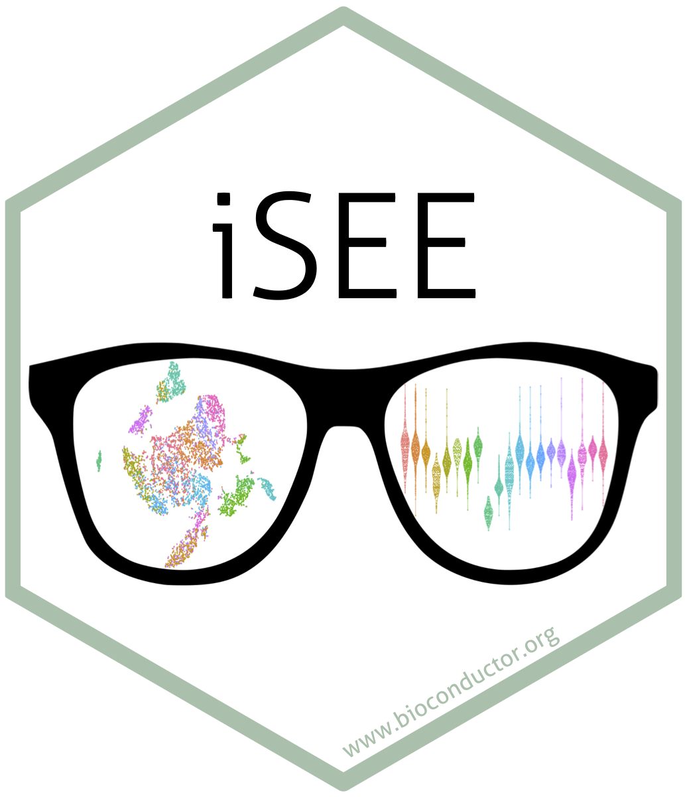
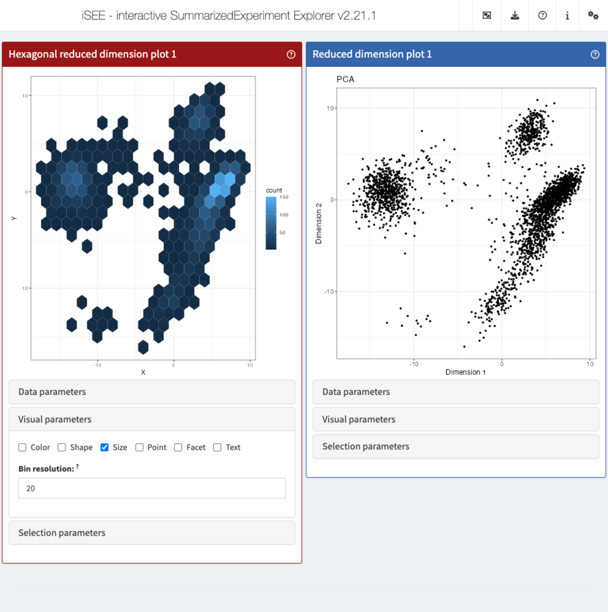
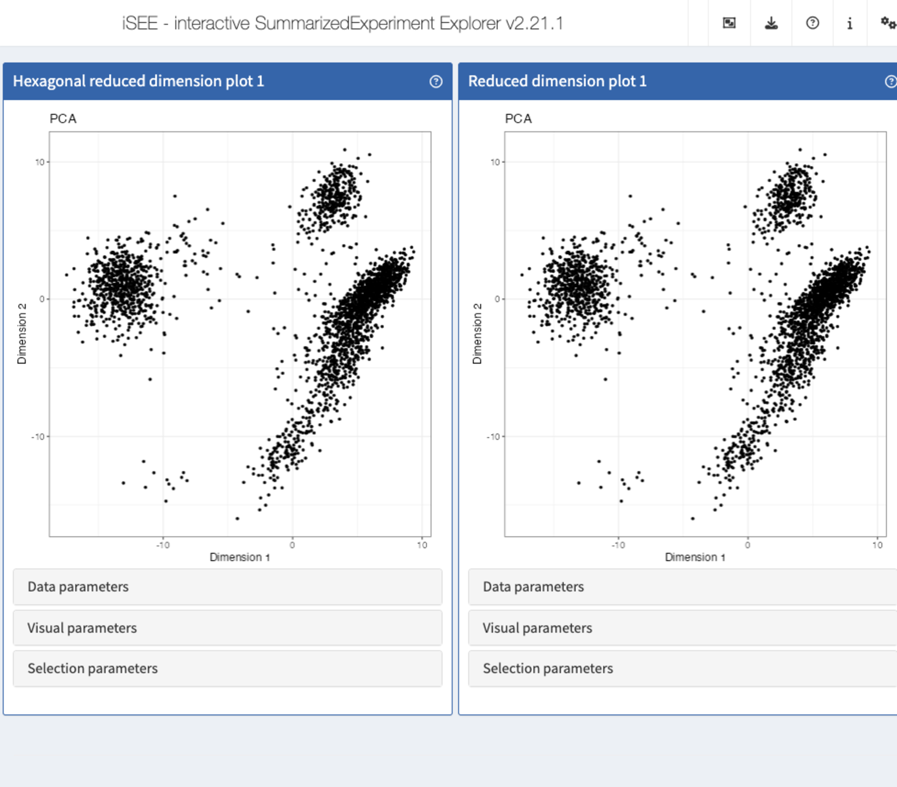
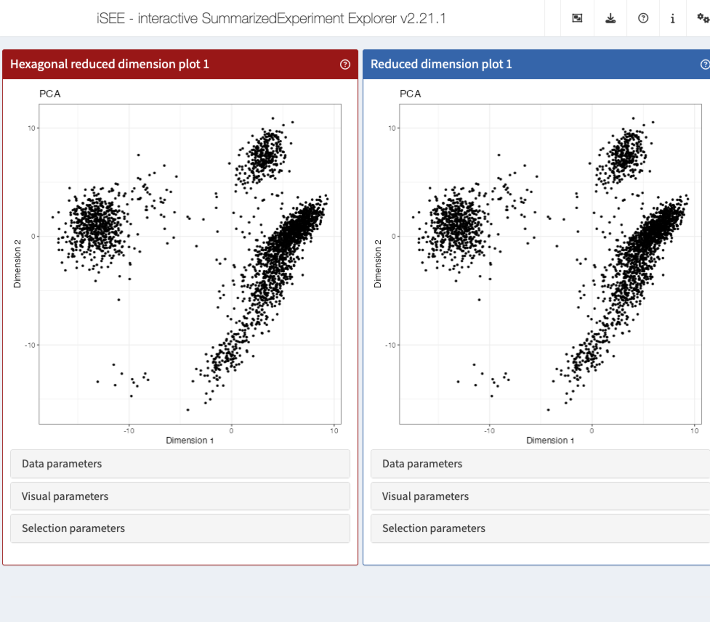
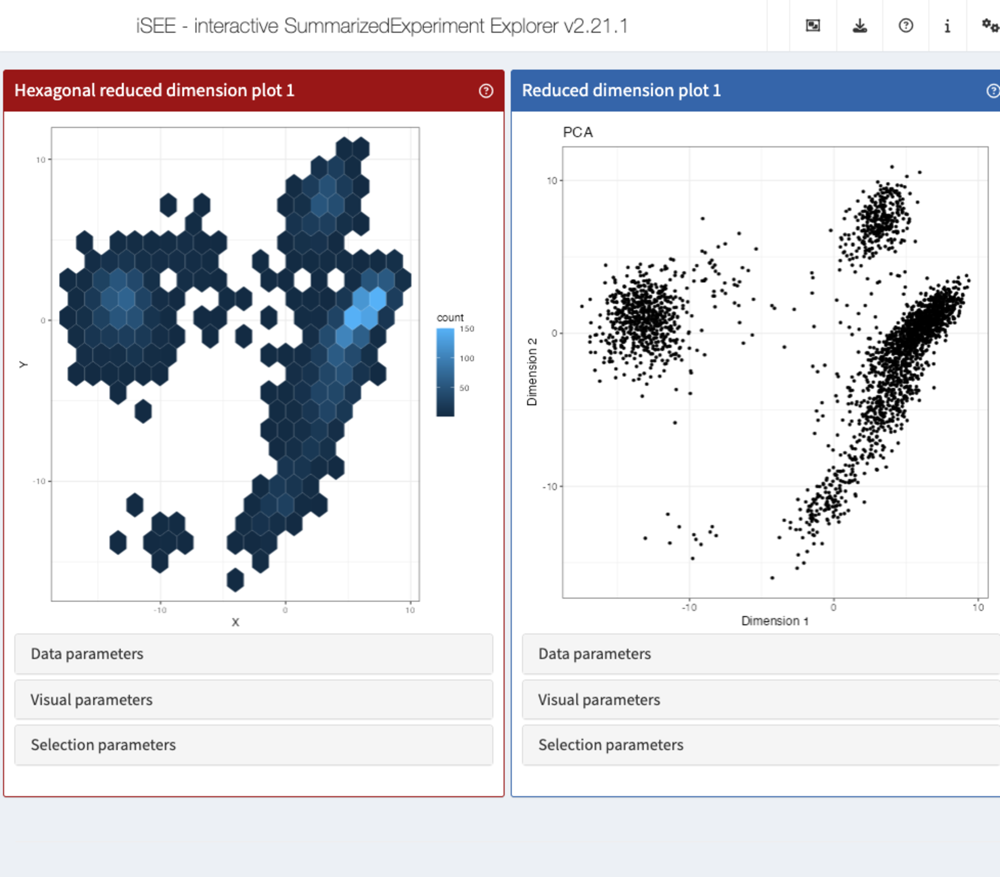

# Extending iSEE

## Writing iSEE extensions

In this vignette, we illustrate how to:

- Extend an existing panel class into a new panel class
- Derive a new panel class from an existing panel

## Load example data

\
[`library`](https://rdrr.io/r/base/library.html)`(`[`"iSEE"`](https://isee.github.io/iSEE/)`)`\
\
`sce`` ``<-`` `[`readRDS`](https://rdrr.io/r/base/readRDS.html)`(`\
`  `[`system.file`](https://rdrr.io/r/base/system.file.html)`(``"datasets"``, ``"sce_pbmc3k.RDS"``, package ``=`` ``"iUSEiSEE"``)`\
`)`

## Philosophy

*[iSEE](https://bioconductor.org/packages/3.23/iSEE)* panels are
implemented as S4 classes that store the state of each panel in
designated slots, and most of the functionality is implemented as S4
methods that describe various behavioural aspects of each panel class.

As a result, new classes can be created simply by inheritance from
existing classes, overwriting methods to produce a different behaviour.

## Deriving an S4 class

In this demo, let us create a new class called
`ReducedDimensionHexagonPlot`, that inherits from the existing class
[`ReducedDimensionPlot()`](https://isee.github.io/iSEE/reference/ReducedDimensionPlot-class.html)
(implemented in the
*[iSEE](https://bioconductor.org/packages/3.23/iSEE)* package).

The objective is to produce a panel that displays the same information
as the original
[`ReducedDimensionPlot()`](https://isee.github.io/iSEE/reference/ReducedDimensionPlot-class.html)
panel, but summarising data points into hexagonal bins.

One major motivation for this functionality is that arbitrarily large
data sets comprising many data points may be summarised into a modest
number of hexagonal bins, providing a boost in speed when rendering the
plot.

However, this is not without caveats:

- Summarising can take many forms (e.g., counting, averaging).
- The ideal number of bins may be different for different data sets.

To proceed, the new class needs at least one additional slot to store
the number of hexagonal bins to create (i.e., a resolution for the
plot).

\
[`setClass`](https://rdrr.io/r/methods/setClass.html)`(``"ReducedDimensionHexagonPlot"``, contains``=``"ReducedDimensionPlot"``, `\
`         slots``=`[`c`](https://rdrr.io/r/base/c.html)`(``BinResolution ``=`` ``"numeric"``)``)`

To properly initialise instances of the new class, the new slot must be
populated with a default value in the event that users do not specify a
bin resolution.

For this, we need to create a new method for the generic
[`initialize()`](https://rdrr.io/r/methods/new.html) and the new class.
We set the default resolution to 20 hexagonal bins along each axis.

\
[`setMethod`](https://rdrr.io/r/methods/setMethod.html)`(``"initialize"``, ``"ReducedDimensionHexagonPlot"``, ``function``(``.Object``, ``...``)`` ``{`\
`  ``args`` ``<-`` `[`list`](https://rdrr.io/r/base/list.html)`(``...``)`\
`  `\
`  ``args`` ``<-`` `[`.emptyDefault`](https://isee.github.io/iSEE/reference/class-utils.html)`(``args``, ``"BinResolution"``, ``20``)`\
`  `\
`  `[`do.call`](https://rdrr.io/pkg/BiocGenerics/man/do.call.html)`(``callNextMethod``, `[`c`](https://rdrr.io/r/base/c.html)`(`[`list`](https://rdrr.io/r/base/list.html)`(``.Object``)``, ``args``)``)`\
`}``)`

## Creating a constructor function

It is best practice to give users a function to create objects a
particular class. Traditionally, the function is named identically to
the class.

In this example, the function passes all its arguments to the
[`new()`](https://rdrr.io/r/methods/new.html) function. This is standard
practice in *[iSEE](https://bioconductor.org/packages/3.23/iSEE)*, where
the arguments for constructor functions are typically the values of the
various slots that describe the initial state of the panel.

\
`ReducedDimensionHexagonPlot`` ``<-`` ``function``(``...``)`` ``{`\
`  `[`new`](https://rdrr.io/r/methods/new.html)`(``"ReducedDimensionHexagonPlot"``, ``...``)`\
`}`

At this point, we can already demonstrate that we have a functional new
panel class… that is a carbon copy of the parent class it inherits from!

\
`app`` ``<-`` `[`iSEE`](https://isee.github.io/iSEE/reference/iSEE.html)`(``sce``, initial ``=`` `[`list`](https://rdrr.io/r/base/list.html)`(`\
`  ``ReducedDimensionHexagonPlot``(``PanelWidth ``=`` ``6L``)``,`\
`  `[`ReducedDimensionPlot`](https://isee.github.io/iSEE/reference/ReducedDimensionPlot-class.html)`(``PanelWidth ``=`` ``6L``)`\
`)``)`

How can we even tell which is which?!

## Changing the public panel name

The generic
[`.fullName()`](https://isee.github.io/iSEE/reference/getEncodedName.html)
declares the label shown in the interface, at the top of each panel.

Let us create a method for the new class, that gives it a different
name, highlighting the hexagonal binning in the plot.

\
[`setMethod`](https://rdrr.io/r/methods/setMethod.html)`(``".fullName"``, ``"ReducedDimensionHexagonPlot"``, `\
`          ``function``(``x``)`` ``"Hexagonal reduced dimension plot"``)`

Let’s launch the app to see the effect

\
`app`` ``<-`` `[`iSEE`](https://isee.github.io/iSEE/reference/iSEE.html)`(``sce``, initial ``=`` `[`list`](https://rdrr.io/r/base/list.html)`(`\
`  ``ReducedDimensionHexagonPlot``(``PanelWidth ``=`` ``6L``)``,`\
`  `[`ReducedDimensionPlot`](https://isee.github.io/iSEE/reference/ReducedDimensionPlot-class.html)`(``PanelWidth ``=`` ``6L``)`\
`)``)`

## Changing the background panel colour

Similarly, the generic
[`.panelColor()`](https://isee.github.io/iSEE/reference/getPanelColor.html)
declares the background colour of the panel header (as well as the
colour of brushes for compatible panels).

Let us create a method for the new class, that gives it a different
colour.

\
[`setMethod`](https://rdrr.io/r/methods/setMethod.html)`(``".panelColor"``, ``"ReducedDimensionHexagonPlot"``, ``function``(``x``)`` ``"#991717"``)`

Let’s launch the app to see the effect

\
`app`` ``<-`` `[`iSEE`](https://isee.github.io/iSEE/reference/iSEE.html)`(``sce``, initial ``=`` `[`list`](https://rdrr.io/r/base/list.html)`(`\
`  ``ReducedDimensionHexagonPlot``(``PanelWidth ``=`` ``6L``)``,`\
`  `[`ReducedDimensionPlot`](https://isee.github.io/iSEE/reference/ReducedDimensionPlot-class.html)`(``PanelWidth ``=`` ``6L``)`\
`)``)`

## Altering the user interface

At this point, there is still no component in the user interface to
control the resolution value store in the new slot.

A number of S4 methods control the interface elements displayed in the
various groups of parameters located under each panel.

Here, we are discussing a parameter that will control the *size* of
bins. Moreover, we are about to replace data points by hexagonal bins,
meaning that the visual parameters controlling the size of data points
are about to become useless.

Thus, the generic
[`.defineVisualSizeInterface()`](https://isee.github.io/iSEE/reference/visual-parameters-generics.html)
is the natural choice to use for replacing the size parameters of the
parent `ReducedDimensionHexagonPlot()` class by a new HTML element that
displays a numeric input allowing users to change the hexagonal bin
resolution.

\
[`setMethod`](https://rdrr.io/r/methods/setMethod.html)`(``".defineVisualSizeInterface"``, ``"ReducedDimensionHexagonPlot"``, ``function``(``x``)`` ``{`\
`  ``plot_name`` ``<-`` `[`.getEncodedName`](https://isee.github.io/iSEE/reference/getEncodedName.html)`(``x``)`\
`  `\
`  ``tagList``(`\
`    `[`.numericInput.iSEE`](https://isee.github.io/iSEE/reference/interface-wrappers.html)`(``x``, ``"BinResolution"``, label``=``"Bin resolution:"``,`\
`                       min``=``1``, value``=``x``[[``"BinResolution"``]``]``, step ``=`` ``1``)`\
`  ``)`\
`}``)`

\
`app`` ``<-`` `[`iSEE`](https://isee.github.io/iSEE/reference/iSEE.html)`(``sce``, initial ``=`` `[`list`](https://rdrr.io/r/base/list.html)`(`\
`  ``ReducedDimensionHexagonPlot``(``PanelWidth ``=`` ``6L``, VisualBoxOpen ``=`` ``TRUE``, VisualChoices ``=`` ``"Size"``)``,`\
`  `[`ReducedDimensionPlot`](https://isee.github.io/iSEE/reference/ReducedDimensionPlot-class.html)`(``PanelWidth ``=`` ``6L``, VisualBoxOpen ``=`` ``TRUE``, VisualChoices ``=`` ``"Size"``)`\
`)``)`

## Altering the panel output

Time for the most exciting and challenging task: making the panel
produce a different type of plot!

To this end, the generic
[`.generateDotPlot()`](https://isee.github.io/iSEE/reference/plot-generics.html)
is key. Given a panel state, axis labels, and an environment that
contains the
[`SummarizedExperiment()`](https://rdrr.io/pkg/SummarizedExperiment/man/SummarizedExperiment-class.html)
object and possibly other relevant values such as incoming selections,

\
[`setMethod`](https://rdrr.io/r/methods/setMethod.html)`(``".generateDotPlot"``, ``"ReducedDimensionHexagonPlot"``, ``function``(``x``, ``labels``, ``envir``)`` ``{`\
`  ``plot_cmds`` ``<-`` `[`list`](https://rdrr.io/r/base/list.html)`(``)`\
`  ``plot_cmds``[[``"ggplot"``]``]`` ``<-`` ``"ggplot() +"`\
`  ``color_lab`` ``<-`` ``"Count"`\
`  ``new_aes`` ``<-`` `[`.buildAes`](https://isee.github.io/iSEE/reference/aes-utils.html)`(``)`\
`  ``plot_cmds``[[``"hex"``]``]`` ``<-`` `[`sprintf`](https://rdrr.io/r/base/sprintf.html)`(`\
`    ``"ggplot2::geom_hex(%s, bins = %i, plot.data) +"``,`\
`    ``new_aes``,`\
`    `[`as.integer`](https://rdrr.io/r/base/integer.html)`(``x``[[``"BinResolution"``]``]``)`\
`  ``)`\
`  ``plot_cmds``[[``"theme_base"``]``]`` ``<-`` ``"theme_bw()"`\
`  `\
`  `[`list`](https://rdrr.io/r/base/list.html)`(``plot``=`[`.textEval`](https://isee.github.io/iSEE/reference/manage_commands.html)`(``plot_cmds``, ``envir``)``, commands``=``plot_cmds``)`\
`}``)`

\
`app`` ``<-`` `[`iSEE`](https://isee.github.io/iSEE/reference/iSEE.html)`(``sce``, initial ``=`` `[`list`](https://rdrr.io/r/base/list.html)`(`\
`  ``ReducedDimensionHexagonPlot``(``PanelWidth ``=`` ``6L``, VisualBoxOpen ``=`` ``TRUE``, VisualChoices ``=`` ``"Size"``)``,`\
`  `[`ReducedDimensionPlot`](https://isee.github.io/iSEE/reference/ReducedDimensionPlot-class.html)`(``PanelWidth ``=`` ``6L``, VisualBoxOpen ``=`` ``TRUE``, VisualChoices ``=`` ``"Size"``)`\
`)``)`

## Adding reactivity

At this point, if users change the bin resolution using the newly added
interface element, they will notice that nothing seems to happen.

That is because we have not yet added a Shiny observer responding to
this particular event.

The
[`.createObservers()`](https://isee.github.io/iSEE/reference/observer-generics.html)
generic is invoked to create observers for all the instances of each
panel class added to the user interface.

The
[`.createProtectedParameterObservers()`](https://isee.github.io/iSEE/reference/createProtectedParameterObservers.html)
function provides a convenient way to create observers responding to
events that change the data being plotted and potentially break active
multiple selections, if any. This function automatically ensures that
any change of value in the interface element is updated in the panel
state and triggers re-rendering of the panel plot.

\
[`setMethod`](https://rdrr.io/r/methods/setMethod.html)`(``".createObservers"``, ``"ReducedDimensionHexagonPlot"``, ``function``(``x``, ``se``, ``input``, ``session``, ``pObjects``, ``rObjects``)`` ``{`\
`    `[`callNextMethod`](https://rdrr.io/r/methods/NextMethod.html)`(``)`\
\
`    ``plot_name`` ``<-`` `[`.getEncodedName`](https://isee.github.io/iSEE/reference/getEncodedName.html)`(``x``)`\
\
`    `[`.createProtectedParameterObservers`](https://isee.github.io/iSEE/reference/createProtectedParameterObservers.html)`(``plot_name``,`\
`        fields``=`[`c`](https://rdrr.io/r/base/c.html)`(``"BinResolution"``)``,`\
`        input``=``input``, pObjects``=``pObjects``, rObjects``=``rObjects``)`\
\
`    `[`invisible`](https://rdrr.io/r/base/invisible.html)`(``NULL``)`\
`}``)`

With the new observer in place, we can launch the app one more time, to
toy with the bin resolution and watch the panel plot being re-rendered
each time.

\
`app`` ``<-`` `[`iSEE`](https://isee.github.io/iSEE/reference/iSEE.html)`(``sce``, initial ``=`` `[`list`](https://rdrr.io/r/base/list.html)`(`\
`  ``ReducedDimensionHexagonPlot``(``PanelWidth ``=`` ``6L``, VisualBoxOpen ``=`` ``TRUE``, VisualChoices ``=`` ``"Size"``)``,`\
`  `[`ReducedDimensionPlot`](https://isee.github.io/iSEE/reference/ReducedDimensionPlot-class.html)`(``PanelWidth ``=`` ``6L``)`\
`)``)`

## Further work

At this point, there are many more aspects of the plotting behaviour
that we should test and adjust, making sure that all the choices of
parameters presented to end users are sensible, and that all
combinations of parameters are handled without error.

However, that work represents many hours of careful testing and
implementation that is far beyond the scope of this short package demo.

Adventurous souls may be interested in a more mature implementation of
the
[`ReducedDimensionHexPlot()`](https://rdrr.io/pkg/iSEEhex/man/ReducedDimensionHexPlot-class.html)
panel class, implemented in the
*[iSEEhex](https://bioconductor.org/packages/3.23/iSEEhex)* package.
Source code can be found on GitHub on [this
page](https://github.com/iSEE/iSEEhex/blob/main/R/ReducedDimensionHexPlot.R).

## Additional resources

The book [Extending iSEE](https://isee.github.io/iSEE-book/) is the
original effort from developers to provide guidance for writing
*[iSEE](https://bioconductor.org/packages/3.23/iSEE)* extensions using
example use cases for illustration.

The more recent [iSEETheBook](https://isee.github.io/iSEETheBook/)
launched a new effort to provide a comprehensive view of the ecosystem
for all three major groups of users:

- End users interacting with the graphical user interface in their web
  browser.
- Developers of scripted web-applications using
  *[iSEE](https://bioconductor.org/packages/3.23/iSEE)* to showcase data
  sets.
- Developers of extensions contributing new functionality and packages
  to the *[iSEE](https://bioconductor.org/packages/3.23/iSEE)*
  ecosystem.

The [iSEE website](https://isee.github.io/) is the place to watch for
links to additional resources.

## Session info

**Session info**

\
[`sessionInfo`](https://rdrr.io/r/utils/sessionInfo.html)`(``)`\
`#> R version 4.6.1 (2026-06-24)`\
`#> Platform: x86_64-pc-linux-gnu`\
`#> Running under: Ubuntu 24.04.5 LTS`\
`#> `\
`#> Matrix products: default`\
`#> BLAS:   /usr/lib/x86_64-linux-gnu/openblas-pthread/libblas.so.3 `\
`#> LAPACK: /usr/lib/x86_64-linux-gnu/openblas-pthread/libopenblasp-r0.3.26.so;  LAPACK version 3.12.0`\
`#> `\
`#> locale:`\
`#>  [1] LC_CTYPE=en_US.UTF-8       LC_NUMERIC=C              `\
`#>  [3] LC_TIME=en_US.UTF-8        LC_COLLATE=en_US.UTF-8    `\
`#>  [5] LC_MONETARY=en_US.UTF-8    LC_MESSAGES=en_US.UTF-8   `\
`#>  [7] LC_PAPER=en_US.UTF-8       LC_NAME=C                 `\
`#>  [9] LC_ADDRESS=C               LC_TELEPHONE=C            `\
`#> [11] LC_MEASUREMENT=en_US.UTF-8 LC_IDENTIFICATION=C       `\
`#> `\
`#> time zone: Etc/UTC`\
`#> tzcode source: system (glibc)`\
`#> `\
`#> attached base packages:`\
`#> [1] stats4    stats     graphics  grDevices utils     datasets  methods  `\
`#> [8] base     `\
`#> `\
`#> other attached packages:`\
`#>  [1] iSEE_2.24.0                 SingleCellExperiment_1.34.0`\
`#>  [3] SummarizedExperiment_1.42.0 Biobase_2.72.0             `\
`#>  [5] GenomicRanges_1.64.0        Seqinfo_1.2.0              `\
`#>  [7] IRanges_2.46.0              S4Vectors_0.50.3           `\
`#>  [9] BiocGenerics_0.58.1         generics_0.1.4             `\
`#> [11] MatrixGenerics_1.24.0       matrixStats_1.5.0          `\
`#> [13] BiocStyle_2.40.0           `\
`#> `\
`#> loaded via a namespace (and not attached):`\
`#>  [1] rlang_1.3.0           magrittr_2.0.5        shinydashboard_0.7.3 `\
`#>  [4] clue_0.3-68           GetoptLong_1.1.1      otel_0.2.0           `\
`#>  [7] compiler_4.6.1        mgcv_1.9-4            png_0.1-9            `\
`#> [10] systemfonts_1.3.2     vctrs_0.7.3           pkgconfig_2.0.3      `\
`#> [13] shape_1.4.6.1         crayon_1.5.3          fastmap_1.2.0        `\
`#> [16] XVector_0.52.0        fontawesome_0.5.3     promises_1.5.0       `\
`#> [19] rmarkdown_2.32        shinyAce_0.4.4        ragg_1.5.2           `\
`#> [22] xfun_0.62             cachem_1.1.0          jsonlite_2.0.0       `\
`#> [25] listviewer_4.0.0      later_1.4.8           DelayedArray_0.38.2  `\
`#> [28] parallel_4.6.1        cluster_2.1.8.3       R6_2.6.1             `\
`#> [31] bslib_0.12.0          RColorBrewer_1.1-3    jquerylib_0.1.4      `\
`#> [34] Rcpp_1.1.2            iterators_1.0.14      knitr_1.52           `\
`#> [37] httpuv_1.6.17         Matrix_1.7-6          splines_4.6.1        `\
`#> [40] igraph_2.3.4          tidyselect_1.2.1      abind_1.4-8          `\
`#> [43] yaml_2.3.12           doParallel_1.0.17     codetools_0.2-20     `\
`#> [46] miniUI_0.1.2          lattice_0.23-1        tibble_3.3.1         `\
`#> [49] shiny_1.14.0          S7_0.2.2              evaluate_1.0.5       `\
`#> [52] desc_1.4.3            circlize_0.4.18       pillar_1.11.1        `\
`#> [55] BiocManager_1.30.27   DT_0.34.0             foreach_1.5.2        `\
`#> [58] shinyjs_2.1.1         ggplot2_4.0.3         scales_1.4.0         `\
`#> [61] xtable_1.8-8          glue_1.8.1            tools_4.6.1          `\
`#> [64] colourpicker_1.3.0    fs_2.1.0              grid_4.6.1           `\
`#> [67] colorspace_2.1-4      nlme_3.1-171          vipor_0.4.7          `\
`#> [70] cli_3.6.6             textshaping_1.0.5     S4Arrays_1.12.1      `\
`#> [73] viridisLite_0.4.3     ComplexHeatmap_2.28.0 dplyr_1.2.1          `\
`#> [76] gtable_0.3.6          rintrojs_0.3.4        sass_0.4.10          `\
`#> [79] digest_0.6.39         SparseArray_1.12.3    ggrepel_0.9.8        `\
`#> [82] rjson_0.2.23          htmlwidgets_1.6.4     farver_2.1.2         `\
`#> [85] htmltools_0.5.9       pkgdown_2.2.1         lifecycle_1.0.5      `\
`#> [88] shinyWidgets_0.9.1    GlobalOptions_0.1.4   mime_0.13`
